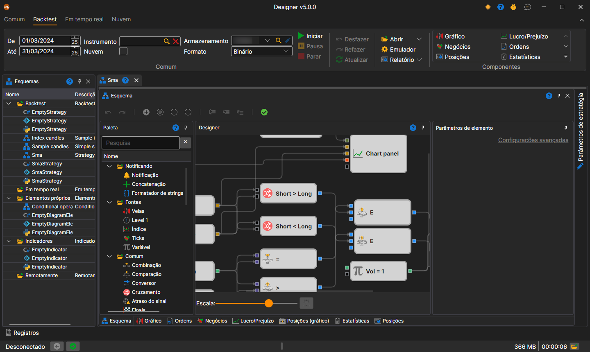
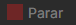
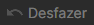

# Interface de utilizador

Para executar o teste no histórico, deve selecionar uma estratégia cujo esquema será testado no histórico. A estratégia é selecionada no painel [Esquemas](../user_interface/schemas.md), na pasta da estratégia, fazendo duplo clique na estratégia pretendida. Ao selecionar uma estratégia, aparece na área de trabalho um novo separador com a estratégia; ao mudar para esse separador, o separador **Backtest** abre automaticamente no friso.

No grupo **Comum** do separador **Backtest** definem-se o período de teste (**De** e **Até**), o **Instrumento**, o armazenamento de dados de mercado (**Armazenamento**) e o formato em que está gravado (**Formato**). A caixa **Nuvem** executa o teste na nuvem da StockSharp e não neste computador.

A estratégia para teste é iniciada clicando no botão **Iniciar** . Depois de iniciar a estratégia para teste, ficam ativos o botão **Pausa** , que suspende o teste, e o botão **Parar** , que para completamente o teste. Ao editar a estratégia, são úteis os botões **Anular** (Ctrl+Z) , que cancela a última ação, **Refazer** (Ctrl+Y) , que repõe a ação anulada, e **Atualizar** (Ctrl+R) , que atualiza completamente o esquema.

Os restantes botões do separador:

- **Abrir** — abrir esta mesma estratégia para [otimização](../optimization/brute_force.md) ou para [negociação](../live_execution/getting_started.md);
- **Emulador** — [definições da emulação](../user_interface/components/backtesting_settings.md);
- **Relatório** — relatório do teste realizado em formato Excel, JSON, XML ou CSV;
- grupo **Componentes** — componentes que se podem adicionar ao separador da estratégia: gráfico, P/L, negócios e outros.

O [depurador](debugging.md) — pontos de interrupção e execução passo a passo — encontra-se no painel **Esquema**.

O separador da estratégia selecionada contém, por predefinição, os seguintes painéis:

- O painel **Esquema**, no qual é realizado o principal processo de trabalho de conceção da estratégia e dos seus componentes, combinando cubos e linhas de ligação. O esquema é descrito em detalhe na secção [Painel do diagrama](../strategies/using_visual_designer/diagram_panel.md).
- Painéis de componentes informativos — **Gráfico**, **Ordens**, **Negócios**, **Lucro/Prejuízo**, **Posições (gráfico)**, **Estatísticas**, **Posições** — como separadores por baixo do esquema.
- O painel **Parâmetros de estratégia**, recolhido por predefinição junto à margem direita do separador da estratégia: os parâmetros do esquema que se podem alterar antes do arranque.

## Conteúdo recomendado

[Definições de testes históricos](../user_interface/components/backtesting_settings.md)
