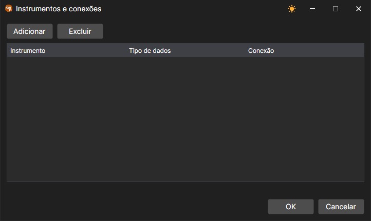

# Mapeamento de símbolos

O mesmo instrumento pode ter nomes diferentes em diferentes sistemas de negociação, e os seus dados e ordens podem passar por ligações diferentes. Para isso, o [Designer](../../designer.md) tem três janelas.

## Mapeamento de códigos

O botão **Mapeamento de códigos** do painel de dados de mercado abre a janela **Códigos de instrumentos <\-> Códigos nos adaptadores**. Na lista por cima da tabela seleciona-se a ligação, o botão  adiciona uma linha e o botão de eliminar remove a selecionada. Nas colunas **Código do instrumento** e **Código do mercado** indica-se o instrumento tal como se chama no **Designer**, e nas colunas **Código no adaptador** e **Código do mercado no adaptador**, tal como lhe chama a ligação selecionada.

## Instrumentos e conexões

A opção **Instrumentos e conexões** da lista pendente do botão **Conectar** do separador **Comum** abre uma janela na qual, para um instrumento e um tipo de dados, se escolhe a ligação através da qual esses dados são recebidos. O botão **Adicionar** adiciona uma linha na qual se preenchem as colunas **Instrumento**, **Tipo de dados** e **Conexão**; o botão **Excluir** remove a linha selecionada.

## Portfólios e Conexões

A opção **Portfólios e Conexões** da mesma lista abre uma janela igual para os portefólios: na coluna **Portfólio** indica-se o portefólio e na coluna **Conexão**, a ligação através da qual são enviadas as suas ordens.

No [Terminal](../../terminal.md), ambas as janelas abrem-se a partir do menu **Configurações** do [menu principal](../../terminal/user_interface/ribbon.md).
