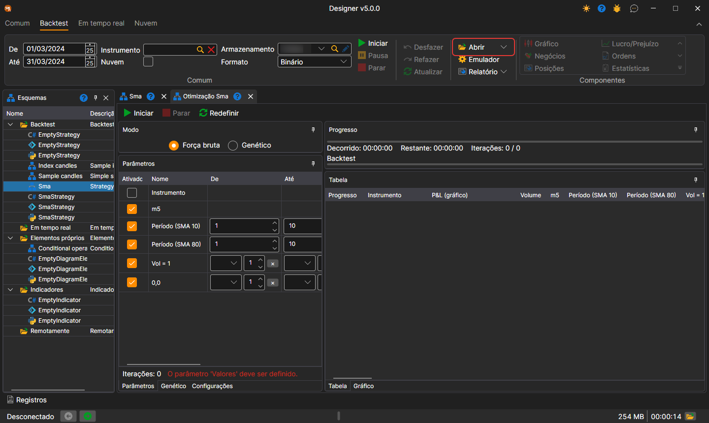
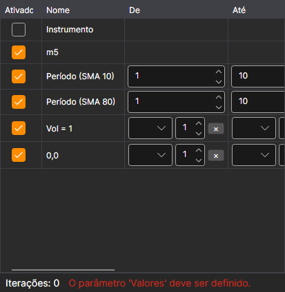
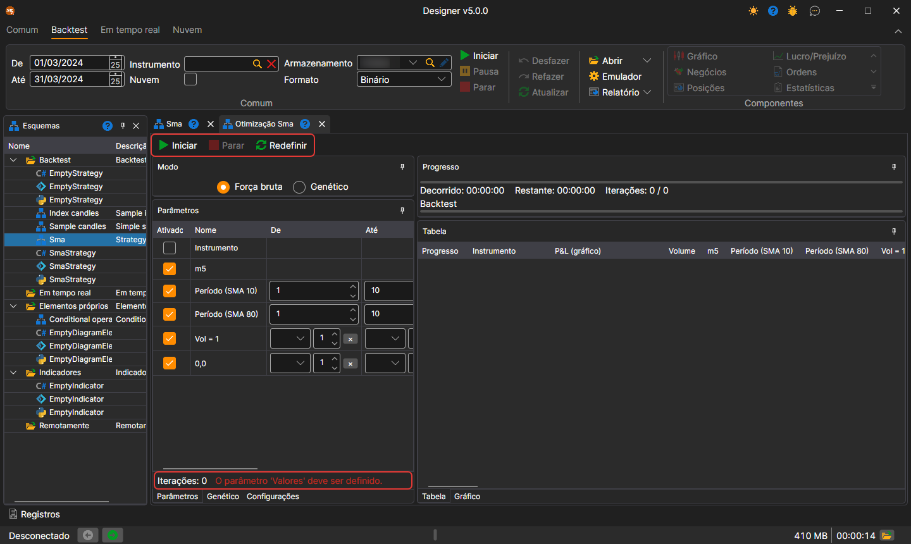

# Força bruta

Para mudar para o modo de otimização de estratégia, no separador **Backtest** abra a lista pendente **Abrir** e selecione **Otimização**. O exemplo de otimização será considerado usando a estratégia SMA criada [a partir de cubos](../strategies/using_visual_designer/first_strategy.md).

Será aberto no espaço de trabalho um separador chamado Otimização + 'Nome da estratégia'. O separador **Otimização** está dividido em duas áreas: à esquerda, o que e como otimizar; à direita, o resultado da otimização:

- No canto superior esquerdo está **Modo**: **Força bruta** ou **Genético**. Por baixo há separadores: **Parâmetros**, com os parâmetros da estratégia que são [iterados](optimization_parameters.md); **Genético**, com as definições da [Genética](genetic.md); **Configurações**, com as definições da emulação e do próprio otimizador, por exemplo, quantas execuções são feitas em simultâneo (**Paralelo**) e quantas iterações são permitidas (**Iterações**).
- À direita está **Progresso**: quanto tempo passou, quanto falta aproximadamente e quantas iterações foram concluídas das planeadas. Por baixo estão o separador **Tabela**, em que cada linha é o resultado do teste da estratégia com parâmetros únicos, e o separador **Gráfico**, que mostra os resultados sob a forma de [gráfico 3D](3d_chart.md).

A definição dos parâmetros para iteração resulta em mais de 1000 iterações. Depois de iniciar o otimizador, o progresso na parte superior, acima dos resultados, mostrará dados sobre o número planeado de iterações, quantas já foram concluídas e quanto tempo será aproximadamente necessário até à conclusão:

## Tabela de parâmetros e botões do painel

Na tabela de parâmetros, cada linha mostra quantos valores produz com os valores **De**, **Até** e **Passo** indicados (coluna **Contagem**) e o que está errado nela (coluna **Erro**), por exemplo, um passo com o qual a iteração não chega ao limite superior. Por baixo da tabela indica-se quantas execuções dará a iteração de todos os parâmetros em conjunto e o primeiro erro, se existir.

Os botões **Iniciar**, **Parar** e **Redefinir** estão diretamente no painel do otimizador e, por baixo deles, está a barra de progresso da execução atual. Na tabela de resultados existe uma coluna **Instrumento**, com o instrumento em que a execução foi feita.

## Consulte também

[Exemplo de testes históricos](../backtesting/getting_started.md)
