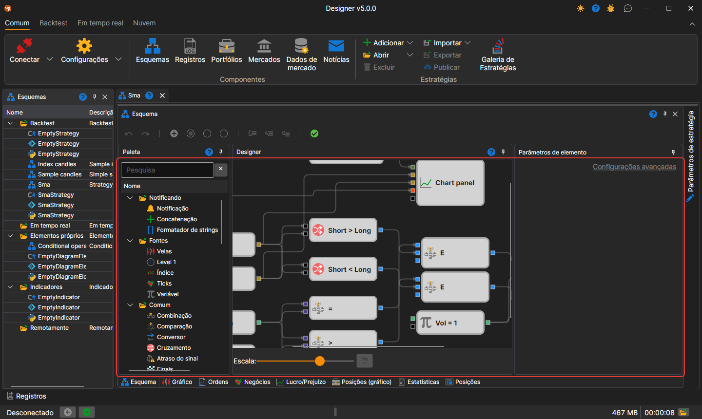
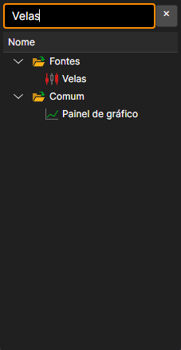
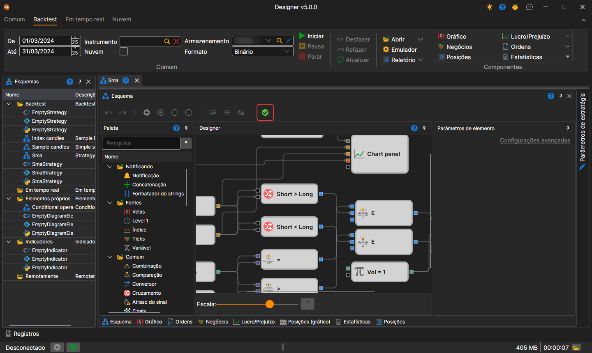
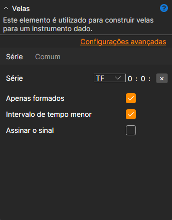
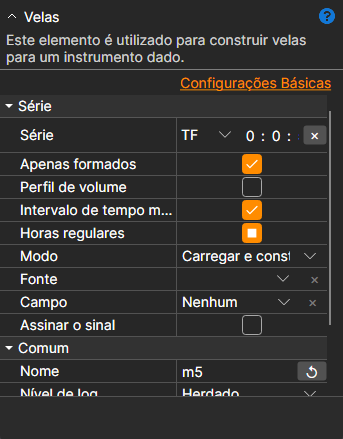

# Designer de estratégias

O principal processo de conceção de uma estratégia e dos seus elementos componentes decorre no painel **Esquema**, através da combinação de blocos e linhas de ligação. O painel Esquema é composto pelos painéis: **Paleta**, **Designer** e **Parâmetros de elemento**.

## Painel Paleta

O painel **Paleta** contém os blocos a partir dos quais as estratégias são criadas. Todos os elementos da paleta estão divididos em categorias, descritas na secção [Descrição dos blocos](elements.md). Para adicionar um bloco ao painel **Designer**, clique com o botão esquerdo do rato no bloco pretendido e, sem soltar o botão, arraste-o para o painel **Designer**. Um duplo clique no bloco coloca-o no centro do painel **Designer**. Depois disso, o elemento será automaticamente selecionado e os seus parâmetros serão mostrados na janela para editar as propriedades do bloco.

A linha de pesquisa por cima da paleta encontra um bloco pelo nome, pela descrição e pelo nome da categoria. A tecla **Enter** coloca no painel **Designer** o bloco selecionado ou, se nada estiver selecionado, o primeiro encontrado.

## Painel Designer

O painel **Designer** é onde ocorre todo o processo de criação de uma estratégia através da combinação de blocos e ligações (linhas). Ele representa visualmente o esquema da estratégia. As informações detalhadas sobre a criação de uma estratégia são descritas na secção [Criar um algoritmo a partir de blocos](first_strategy.md).

Os blocos selecionados deslocam-se com as setas do teclado: um passo ou, com **Shift** premida, dez. Enquanto se arrasta uma linha de ligação, só ficam destacados os conectores aos quais é possível ligá-la, e a ponta da linha ajusta-se sozinha ao mais próximo.

A escala do esquema muda-se com o controlo deslizante **Escala** por baixo do painel ou com a roda do rato com **Ctrl** premida. Teclas do painel **Designer**:

| Teclas | Ação |
|---|---|
| **Ctrl+Z**, **Ctrl+Y** | anular e refazer uma ação |
| **Ctrl+C**, **Ctrl+X**, **Ctrl+V** | copiar, cortar e colar os blocos selecionados |
| **Ctrl+A** | selecionar todos os blocos |
| **Delete** | eliminar a seleção |
| **Esc** | remover a seleção ou interromper o arrasto de uma linha |
| **Ctrl+«+»**, **Ctrl+«−»** | aumentar e reduzir a escala |
| **Ctrl+0** | repor a escala original |
| **Ctrl+1** | ajustar todo o esquema ao painel |
| **Alt+Z** | ajustar o esquema ao painel ou repor a escala anterior |

O botão com um visto na barra do esquema (a sua dica é **Validar o diagrama gerando e compilando o seu código**) verifica o esquema sem iniciar a estratégia. Se o esquema tiver um erro, o seu texto é apresentado a vermelho por cima do painel **Designer**; aí também são apresentados os erros do depurador.

## Painel Parâmetros de elemento

O painel **Parâmetros de elemento** apresenta os parâmetros do bloco selecionado no painel **Designer**. O bloco selecionado é destacado com uma moldura.

O painel **Parâmetros de elemento** pode ser apresentado em dois modos: *Definições básicas* e *Definições avançadas*.

Por predefinição, ao construir um esquema, as propriedades são inicialmente apresentadas no modo *Definições básicas*. Para mudar para o modo *Definições avançadas*, tem de clicar no título correspondente.

No modo *definições básicas*, são apresentadas apenas as propriedades mais necessárias do bloco. Por exemplo, para o bloco [Velas](elements/data_sources/candles.md), serão apresentados o período, a opção para receber apenas velas formadas, a opção para construir velas a partir de um período menor e a opção para subscrever velas por sinal.

No modo *definições avançadas*, serão apresentadas todas as propriedades do bloco disponíveis para alteração e definição.

Todos os blocos contêm um conjunto de propriedades predefinidas, que ficam visíveis no modo *definições avançadas*:

- **Nome** - o nome do elemento, apresentado no designer.
- **Nível de registo** - o nível de registo para este elemento.
- **Parâmetros** - apresenta os parâmetros do elemento em elementos de nível superior.
- **Conectores** - apresenta os conectores do elemento em elementos de nível superior.

As informações detalhadas sobre as propriedades de cada bloco são descritas na secção [Descrição dos blocos](elements.md).

## Ver também

[Descrição dos blocos](elements.md)
