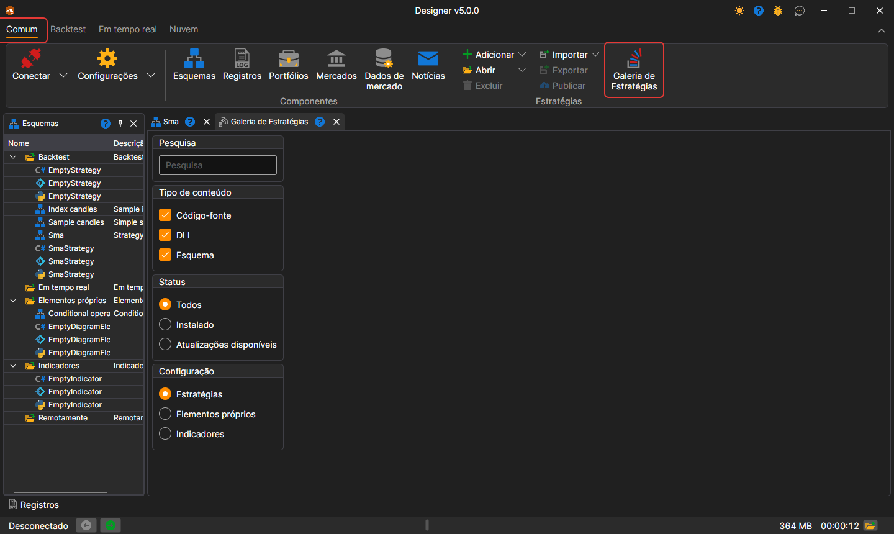

# Galeria de estratégias

A **Galeria de estratégias** oferece a possibilidade de transferir estratégias de negociação prontas para o seu computador. Pode abrir a **Galeria de estratégias** clicando no botão **Galeria de estratégias** no separador **Geral**.

Os cartões das estratégias aparecem à medida que o catálogo é lido a partir do site e, enquanto a leitura decorre, o painel mostra o texto **Carregando estratégias da galeria...**. Se não for possível ler o catálogo, o painel mostra a causa e o botão **Atualizar**, que repete o carregamento.

Para transferir uma estratégia para o seu computador, tem de:

- selecionar a estratégia pretendida e clicar no botão Transferir:

  

- a estratégia será adicionada à árvore de estratégias na secção **Backtest**:

  

## Ver também

[Publicar a sua estratégia](strategy_gallery/publish_own_strategy.md)
