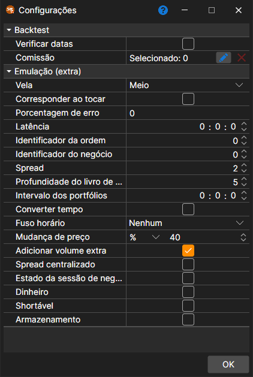

# Definições de testes históricos

As definições da emulação abrem-se com o botão **Emulador** do separador **Backtest** do friso, quando está aberta uma estratégia para teste no histórico ou para otimização. Ao selecionar uma propriedade, aparece a sua descrição detalhada na parte inferior da janela. As propriedades estão agrupadas:

**Backtest**

- **Verificar datas** - verificar se os dias carregados são dias de negociação.
- **[Comissão](../commissions.md)** - a comissão (corretagem, bolsa, etc.).

**Emulação (extra)**

- **Vela** - a que preço da vela são executadas as ordens quando o teste é feito com velas: meio, abertura, máximo, mínimo ou fecho.
- **Combinar ao tocar** - durante a emulação, combinar ordens quando o preço do negócio toca no preço da ordem (ou seja, é igual ao preço da ordem).
- **Percentagem de erros** - o valor percentual do erro no registo de novas ordens. O valor pode ir de 0 (não haverá erros) a 100.
- **Latência** - o valor mínimo da latência da ordem registada.
- **ID da ordem** - o número a partir do qual o emulador irá gerar identificadores para ordens.
- **ID do negócio** - o número a partir do qual o emulador irá gerar identificadores para negócios.
- **Spread** - o tamanho do spread em passos de preço. É utilizado ao especificar o spread para gerar um livro de ordens a partir de negócios tick.
- **Profundidade do livro** - a profundidade máxima do livro de ordens que será gerado a partir dos ticks.
- **Intervalo dos portefólios** - o intervalo para recálculo da carteira. Se o intervalo for zero, não é efectuado qualquer recálculo.
- **Alterar hora** - para alterar a hora de ordens e negócios para a hora da bolsa.
- **Fuso horário** - o fuso horário da bolsa.
- **Desvio de preço** - o deslocamento de preço face ao último negócio, especificando os limites dos preços máximo e mínimo para a sessão seguinte.
- **Adicionar volume extra** - adicionar volume extra ao livro de ordens quando estão a ser registadas ordens com grande volume.
- **Spread centralizado** - repartir o spread por igual em torno dos preços para os quais não se sabe que lado negociou (por exemplo, os preços das velas), para que a compra e a venda paguem a mesma metade do spread.
- **Estado da sessão de negociação** - verificar o estado de negociação.
- **Dinheiro** - verificar o saldo monetário.
- **Shortável** - se é possível abrir posições curtas.
- **Armazenamento** - permitir guardar as mensagens criadas pelo emulador.

O período de teste, o instrumento, o armazenamento de dados de mercado e o seu formato definem-se no próprio separador **Backtest** ([Interface](../../backtesting/user_interface.md)), e os parâmetros do esquema, no painel **Parâmetros de estratégia**, junto à margem direita do separador da estratégia.

## Conteúdo recomendado

[Gráfico](chart.md)
