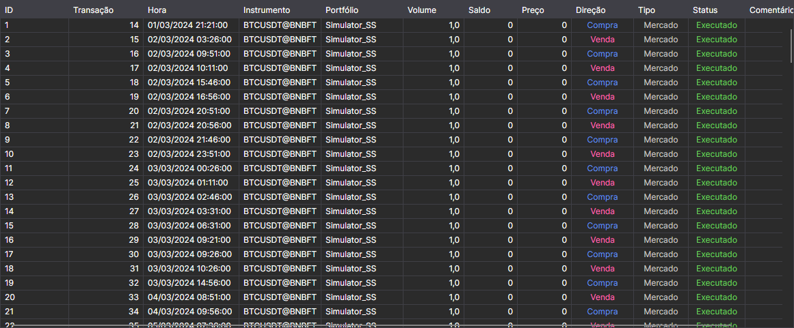

# Ordens

O componente **Ordens** é uma tabela de ordens que apresenta informações completas sobre todas as ordens da estratégia.

A lista por cima da tabela escolhe que ordens mostrar: **Todos**, apenas as ativas (**Ativo**), as executadas (**Executado**) ou as rejeitadas (**Falhou**).

Como copiar as linhas da tabela, pesquisá-las e filtrá-las e configurar as colunas é descrito na secção [Trabalho com tabelas](../../../terminal/user_interface/tables.md).

## Conteúdo recomendado

[Negócios](trades.md)
