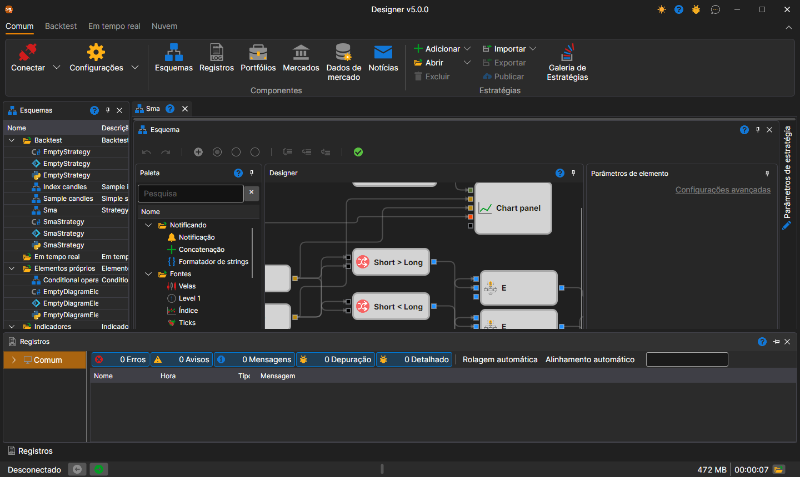

# Área de trabalho

A **Área de trabalho** no [Designer](../../designer.md) é uma interface em janelas com ancoragem de painéis semelhante à usada no Microsoft Visual Studio. Ao clicar no cabeçalho do painel com o botão esquerdo do rato e mantê-lo premido, pode fixar o painel num local conveniente. Ao arrastar as extremidades do painel, pode ajustar a sua altura ou largura:

Na parte inferior da janela está a barra de estado: se o [Designer](../../designer.md) está ligado (**Desconectado**, **Conectado** ou o texto do erro de ligação), as notícias da StockSharp, os contadores de avisos e erros do registo, a última mensagem do registo (um clique nela abre o [Painel de registos](logs.md)), a memória ocupada, o tempo de funcionamento e o botão da pasta de registos. Estas partes são descritas com mais detalhe na secção [Barra de estado](../../terminal/user_interface/status_bar.md) do Terminal.

## Conteúdo recomendado

[Painel de esquemas](schemas.md)
