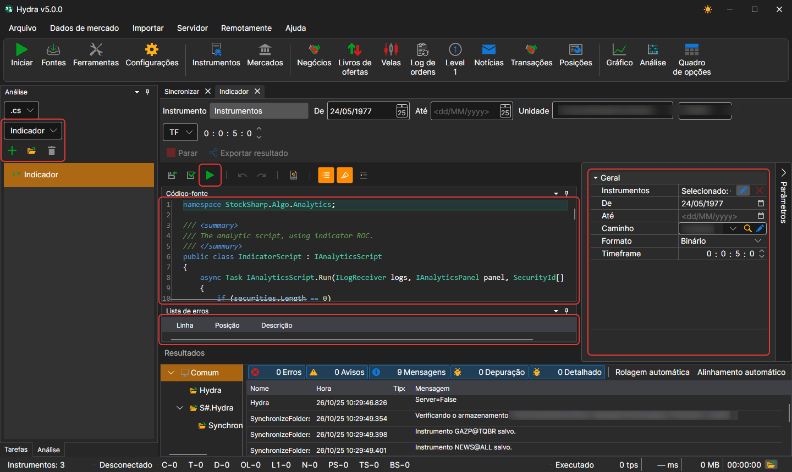
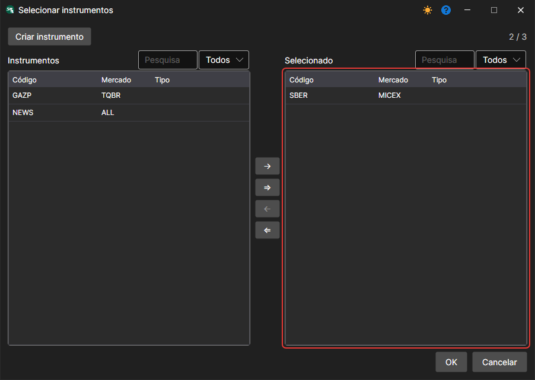

# Executar um Script

Para criar um novo script analítico, abra o separador **Análise** do painel esquerdo, escolha a linguagem do script e o modelo para um arranque rápido e prima **Adicionar**. O script abre-se num separador à parte:

A captura de ecrã apresenta a interface principal desta funcionalidade, composta por vários componentes principais:

- **Painel «Análise»**: à esquerda escolhem-se a linguagem e o modelo do novo script (volume intradiário, perfil de volume, gráficos, indicadores e outras ferramentas de análise); por baixo estão os botões com ícones **Adicionar**, **Abrir** e **Excluir** (o nome do botão vê-se na dica) e a lista de scripts criados.
- **Parâmetros de execução e botões**: por cima do código definem-se os instrumentos, o período, o armazenamento, o formato e o período das velas, e com os botões executam-se **Salvar fonte**, **Referências** (bibliotecas e pacotes referenciados pelo script), **Compilar e executar fonte**, **Parar** e **Exportar resultado**.
- **Janela de Código**: A janela de código apresenta o código-fonte do script analítico selecionado. Os utilizadores podem editar diretamente o código para personalizar ou criar cálculos analíticos e estratégias.
- **Painel de Parâmetros**: à direita, abre-se com o botão **Parâmetros**; nele definem-se os parâmetros dos scripts analíticos, incluindo a seleção de instrumentos, período de análise, caminho dos dados e outras definições.
- **Lista de Erros**: Na parte inferior da interface, existe uma lista de erros detetados durante a compilação ou execução do script analítico.

O script analítico é formatado como uma classe herdada de [IAnalyticsScript](xref:StockSharp.Algo.Analytics.IAnalyticsScript).

Ao definir parâmetros:

- O **Instrumento** pode ser definido de um a vários instrumentos, consoante a lógica do script.

- O intervalo de datas.
- O armazenamento de onde obter os dados.
- O intervalo de tempo de trabalho do script, caso utilize um.

Ao clicar no botão , o script é compilado e executado, e os resultados da sua execução abrem-se num novo separador.
