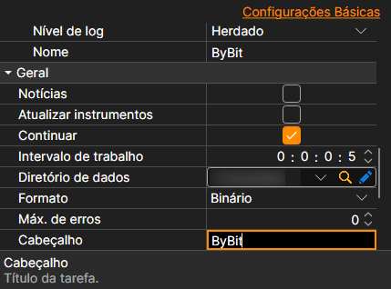

# Definições comuns de ligação

Propriedades de ligação comuns a todas as fontes.

**Geral**

As definições próprias de cada fonte vêm primeiro: chaves, endereços, religação. Seguem-se as comuns a todas as fontes:

- **Notícias** - transferir notícias.
- **Atualizar instrumentos** - atualizar instrumentos ao estabelecer ligação.
- **Continuar** - continuar a transferência a partir da última data transferida.
- **Intervalo de trabalho** - intervalo de funcionamento.
- **Diretório de dados** - diretório com os dados onde serão guardados os ficheiros finais no formato StockSharp.
- **Formato** - formato dos dados: BIN\/CSV.
- **Máx. erros** - número máximo de erros após o qual a tarefa será parada. A predefinição é 0, o que significa ignorar o número de erros.
- **Título** - nome da tarefa.
- **Horário de trabalho** - horário de funcionamento da tarefa.
- **Validação** - o que fazer com os dados que não passam na validação: nada, eliminá-los ou parar a subscrição.

**Remotamente**

- **Ativado** - controlar a tarefa remotamente.
- **Notificação** - canal para o qual chegam as notificações sobre a tarefa.
- **Nível de registo** - que mensagens da tarefa são enviadas para o canal.
