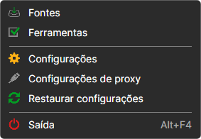
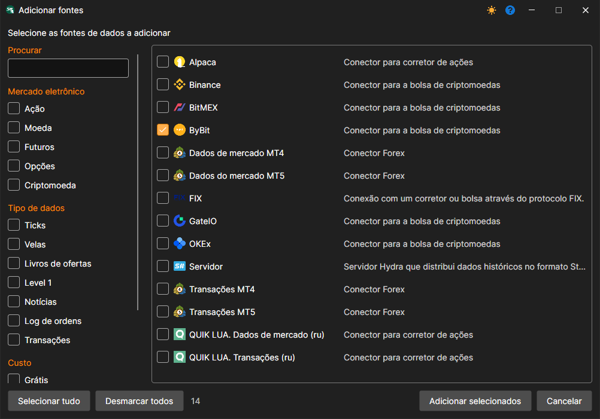
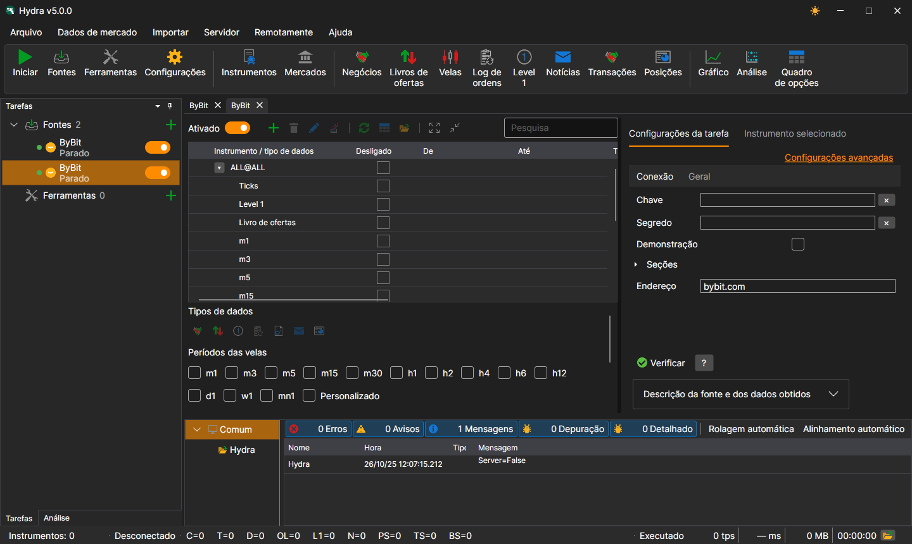
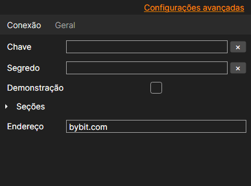

# Selecionar fonte

Para adicionar uma nova fonte de dados de mercado, abra o menu **Arquivo** e selecione a opção **Fontes**, ou prima o botão **Fontes** da barra de ferramentas.

Abre-se a lista de fontes. É possível marcar várias de uma só vez (com um clique na caixa ou no nome) e premir **Adicionar selecionados**.

Também é possível adicionar várias instâncias da mesma fonte, por exemplo, duas **ByBit** com chaves diferentes ou com pastas diferentes para os dados transferidos. Cada instância é uma tarefa à parte no painel **Tarefas**. Para as distinguir serve o **Título** do separador **Geral** das definições da fonte.

Para que a fonte transfira dados depois de clicar no botão **Iniciar**, esta deve estar ativada. Para isso serve o interruptor : cada fonte tem-no no painel **Tarefas** e também existe por cima da tabela de instrumentos da fonte (**Ativado**). A fonte pode ser ativada antes ou depois de adicionar instrumentos.

Uma fonte desnecessária elimina-se com o comando **Excluir** do menu de contexto da fonte no painel **Tarefas**.

As definições da fonte estão no separador **Configurações da tarefa**, à direita da tabela de instrumentos. No separador **Conexão** está o indispensável para que a fonte se ligue: chaves, endereço, etc.; no separador **Geral**, o resto. A ligação **Configurações avançadas** mostra todos os parâmetros da fonte, e não apenas os principais.

As definições comuns a todas as fontes encontram-se no item [Definições comuns de ligação](common_connection_settings.md).

Cada ligação tem as suas próprias características. A ligação [Lista de conectores](../data_sources.md) fornece uma lista de conectores e respetivas definições.

**Ver [tutorial em vídeo](../videos/sources_samples.md)**
