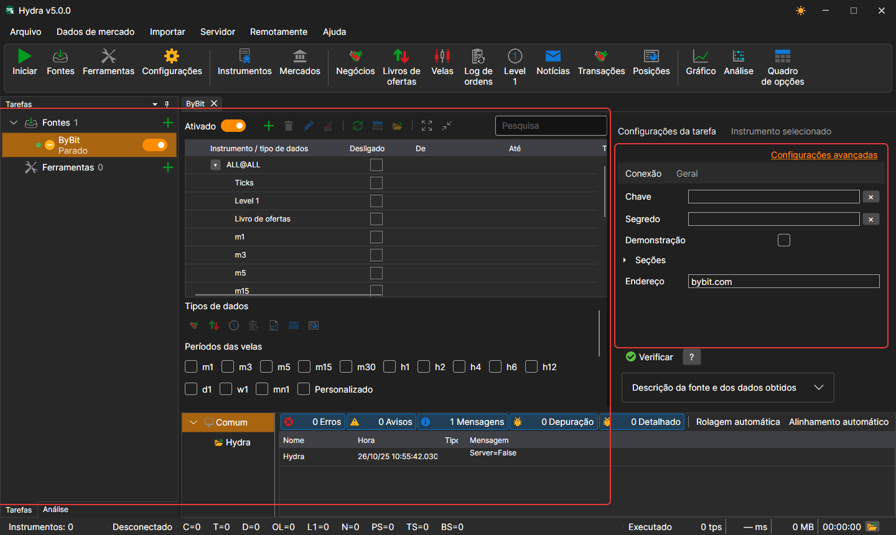
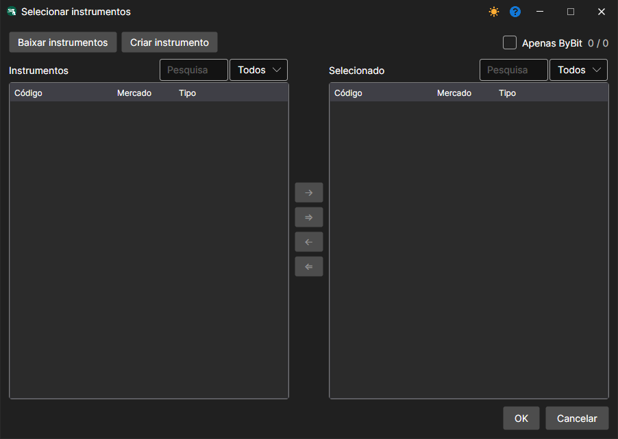
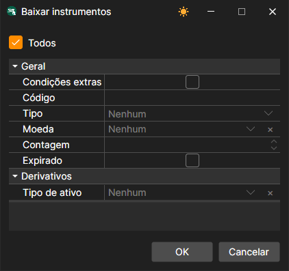
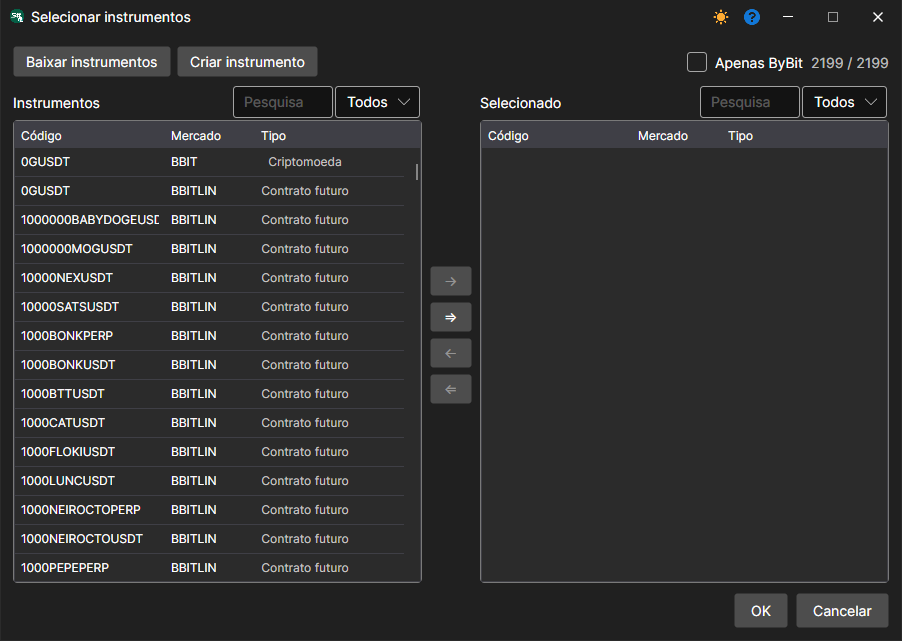
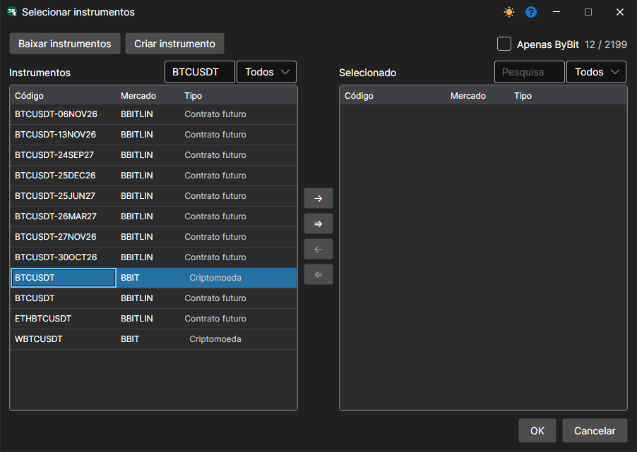
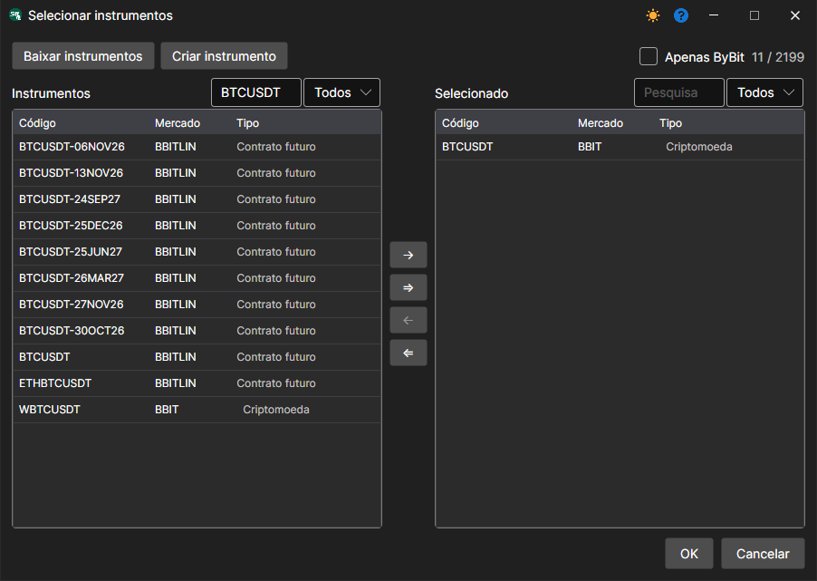
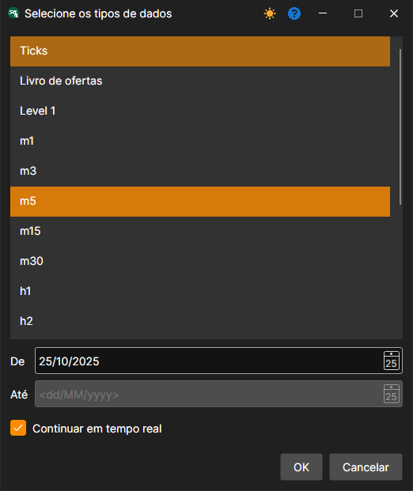
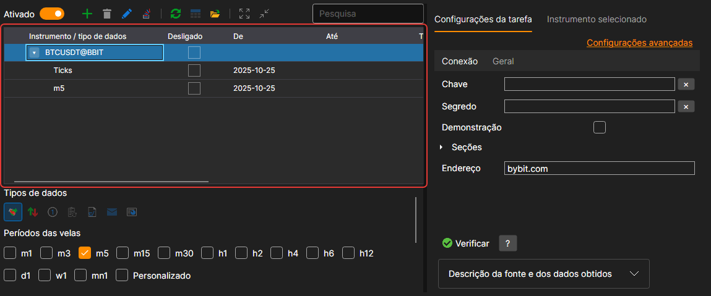
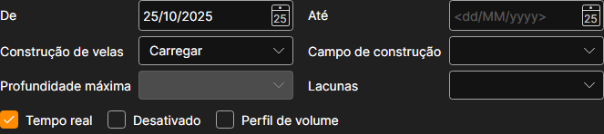
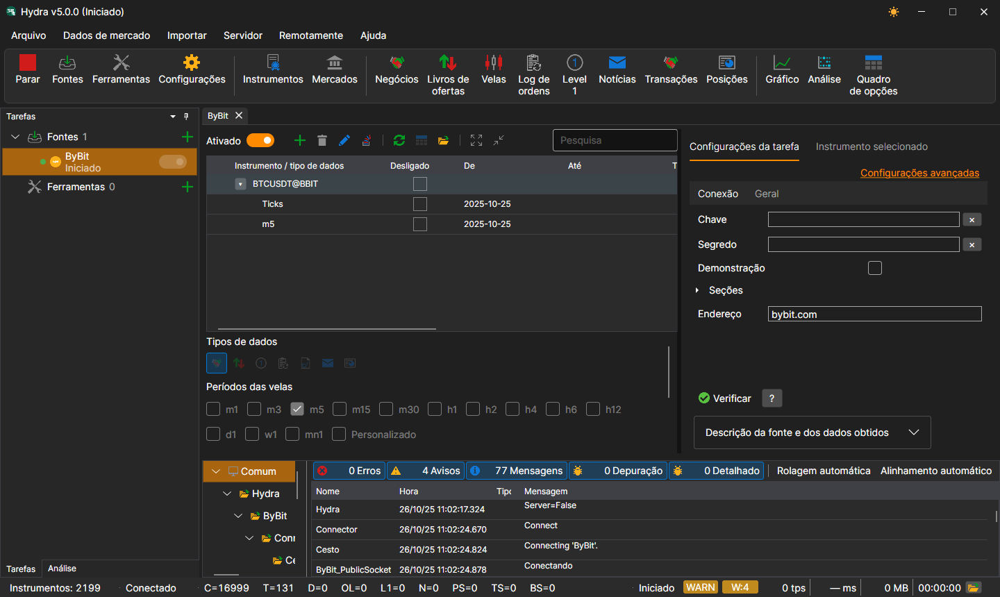

# Primeiro arranque

No primeiro arranque, o Hydra propõe escolher as fontes de dados. Mais tarde, esta mesma janela abre-se com o botão **Fontes** da barra de ferramentas ou a partir do menu **Arquivo**.

Assinale as fontes necessárias: pode clicar tanto na caixa como no nome. Os filtros à esquerda reduzem a lista: mercado eletrónico, tipo de dados, custo; o campo **Procurar** pesquisa pelo nome. Como exemplo, assinalemos **ByBit** e premimos **Adicionar selecionados**.

Em seguida, abre-se uma janela igual com os utilitários, tarefas que não transferem dados, mas trabalham com os já transferidos: importação e exportação agendadas, conversão, cópia de segurança na nuvem. Mais informações sobre eles na secção [Utilitários](tasks.md). Se ainda não precisar de utilitários, prima **Cancelar**.

Para cada fonte adicionada, o Hydra pergunta se a deve ativar já. Uma fonte ativada transfere dados quando o botão **Iniciar** é premido; uma desativada é ignorada. Responda **Sim**.

A fonte aparece no painel **Tarefas** à esquerda e, no centro, abre-se o seu painel: a tabela de instrumentos; por baixo, as definições dos dados recebidos, e à direita, as definições de ligação.

## Instrumentos

> [!TIP]
> Os dados são transferidos apenas para os instrumentos adicionados à fonte.

Logo após ser adicionada, a fonte só tem o instrumento auxiliar **ALL@ALL**, «todos os instrumentos da fonte». Com ele são transferidos os dados que a fonte consegue fornecer de uma só vez para todos os seus instrumentos. Como exemplo, adicionemos o par à vista BTCUSDT.

1. Prima o botão **Adicionar instrumentos**  por cima da tabela de instrumentos. Abre-se a janela de seleção: à esquerda, os instrumentos que o Hydra conhece; à direita, os selecionados para a fonte.

   

2. Da primeira vez, a lista à esquerda está vazia: o Hydra ainda não conhece nenhum instrumento. Prima **Baixar instrumentos**. Na janela que se abre definem-se as condições de pesquisa; a caixa **Todos** pede à fonte a lista completa.

   

   Para algumas fontes, em vez da lista completa, é possível [indicar](prepare_for_download/instruments_list.md) os instrumentos necessários.

3. Prima **OK**. Quando a fonte responder, o Hydra informa quantos instrumentos novos foram adicionados, e estes aparecem na lista à esquerda. O contador por cima da lista mostra quantos instrumentos estão visíveis e quantos são conhecidos no total; a caixa **Apenas ByBit** oculta os instrumentos que já são transferidos por outras fontes.

   

4. Comece a escrever o código do instrumento no campo **Pesquisa** por cima da lista.

   

5. Passe o instrumento para a direita com um duplo clique ou com o botão da seta e prima **OK**.

   

## Tipos de dados e período

Depois de selecionar os instrumentos, o Hydra pergunta que dados transferir para eles. Assinalemos **Ticks** e as velas de cinco minutos **TF: 00:05:00**; cada clique acrescenta mais um tipo à seleção.

A data **De** é o início do histórico. A caixa **Continuar em tempo real** faz com que a fonte continue a receber dados depois de transferido o histórico; com ela, a data **Até** não é necessária. Quanto histórico a fonte fornece depende da própria fonte.

Depois de **OK**, o instrumento aparece na tabela da fonte. A tabela é hierárquica: na linha do instrumento está o seu código e, por baixo, os tipos de dados selecionados com as datas de início e de fim.

Se para um instrumento não tiver sido selecionado nenhum tipo de dados ou se não tiver definidos o passo de preço, o passo de volume ou o número de casas decimais, aparece o ícone ⚠ à esquerda da sua linha. A dica do ícone explica o que falta.

Por baixo da tabela estão as definições das linhas selecionadas nela. Selecione uma ou várias linhas, e as definições aplicam-se a todas de uma só vez:

- **Tipos de dados**: que dados receber. O conjunto depende da fonte.

  

- **Períodos das velas**: que velas transferir. A lista de períodos também depende da fonte; **Personalizado** abre uma janela na qual se define um [tipo de vela próprio](prepare_for_download/custom_candles.md).

  

- **De** e **Até**: período de transferência. Sem data de fim, a fonte transfere tudo o que existe até hoje e, se conseguir trabalhar em tempo real e a caixa **Tempo real** estiver assinalada, continua a receber dados depois disso.

  **Construção de velas**: de onde vêm as velas: **Carregar**, já prontas a partir da fonte; **Construção**, construídas pelo próprio Hydra; **Carregar e construir**, carregadas e as que faltam são construídas. **Campo de construção**: a partir de que se constroem: do preço do último negócio, do ponto médio do spread, do melhor preço, etc. Construir velas é útil quando a fonte não as fornece no período necessário.

  

## Transferência

Prima **Iniciar** na barra de ferramentas. A fonte liga-se e começa a transferência. O progresso vê-se no painel **Registros** na parte inferior da janela, e a barra de estado conta os dados recebidos: **C**, velas; **T**, ticks, etc. Os registos também são guardados em ficheiros na pasta do Hydra.

Também é possível adicionar [outras fontes](data_sources/select_source.md).

Os dados transferidos podem ser [visualizados](working_with_data/view_and_export.md), com eles é possível [construir velas](working_with_data/candles_generation.md) e podem ser [exportados](working_with_data/export_data.md) para vários formatos.

**Ver [tutorial em vídeo](videos/first_start.md)**.
