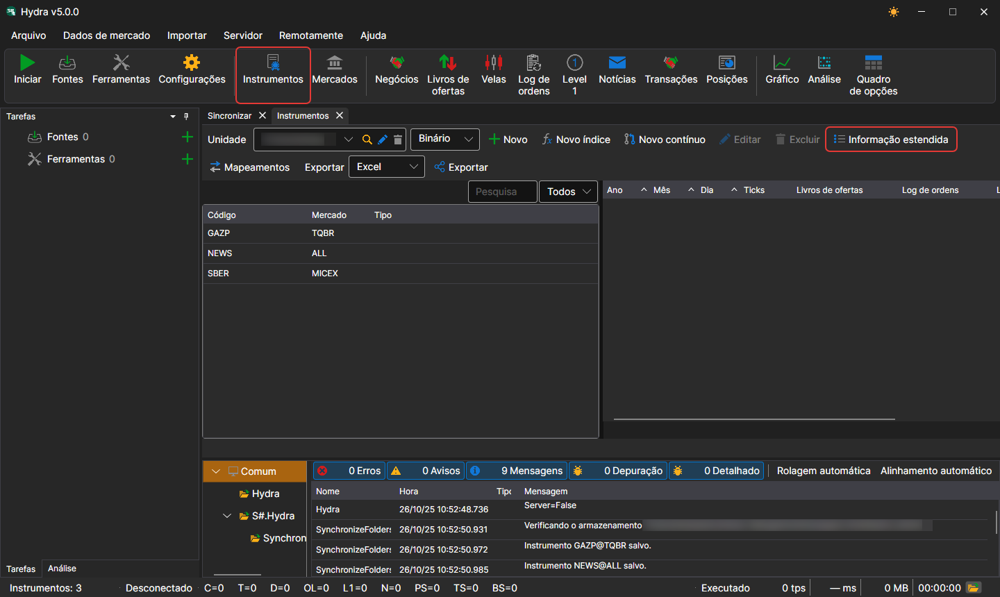
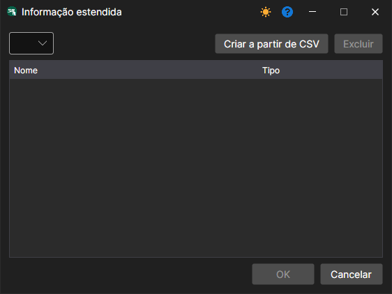

# Informações alargadas do instrumento

As fontes de informações alargadas são ficheiros **CSV** localizados na pasta `c:\\Users\\Users\\Documents\\StockSharp\\Hydra\\Extended info\\`. São carregados automaticamente quando o [Hydra](../../hydra.md) inicia.

As informações alargadas podem incluir quaisquer detalhes adicionais sobre um instrumento (por exemplo, país, cidade, mercado, etc.).

Cada fonte de informações alargadas (ficheiro CSV) contém uma lista de instrumentos e as propriedades disponíveis. Para cada fonte, as informações alargadas são únicas.

Se a fonte não contiver informações alargadas para um instrumento, as colunas correspondentes na lista de instrumentos ficarão vazias.

Para selecionar as informações alargadas necessárias, deve:

1. No painel **Instrumentos**, clique no botão **Informação alargada**
2. Aparecerá uma janela na qual deve selecionar o caminho para o ficheiro CSV necessário

Abaixo está um exemplo de um ficheiro **CSV** de informações alargadas. Os valores são separados por ponto e vírgula: a primeira linha contém os nomes das propriedades, a segunda, os seus tipos, e cada uma das seguintes, o identificador do instrumento e os valores das suas propriedades:

```
SecurityId;Country;City;Site
string;string;string;string
SBER@TQBR;Rússia;Moscovo;www.sberbank.ru
GAZP@TQBR;Rússia;São Petersburgo;www.gazprom.ru
```
