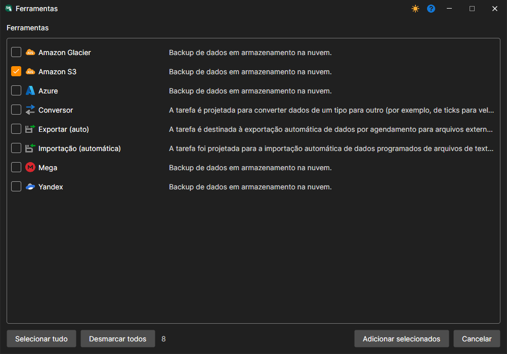
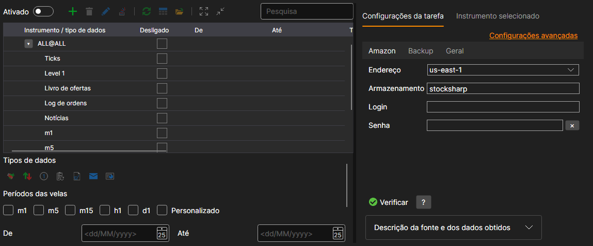

# Definições do Hydra

A seguir descreve-se como criar e configurar uma tarefa de cópia de segurança.

1. Para criar uma tarefa, clique no botão **Ferramentas**; na janela que se abre, assinale o item **Amazon S3** e clique no botão **Adicionar selecionados**. À pergunta sobre se pretende ativar a tarefa já, pode responder **Não**: a tarefa ativa-se com o interruptor depois de configurada.
2. Em seguida, é necessário configurar a tarefa. As definições estão divididas em separadores, e a ligação **Configurações avançadas** mostra-as todas numa única lista.

   **Amazon**
   - **Endereço** - a região especificada nas definições do bucket. Consulte [Regiões e endpoints](https://docs.aws.amazon.com/general/latest/gr/rande.html#s3_region).
   - **Armazenamento** - o nome do bucket.
   - **Início de sessão** - chave de acesso **Access Key ID**.
   - **Palavra-passe** - chave de acesso **Secret Access Key**.

   **Backup**
   - **Pasta** - pasta na nuvem para a qual os dados são carregados. Se não for definida, os dados são carregados para a raiz do bucket.
   - **Desfasamento temporal** - um desvio em dias a partir da data atual, para não copiar os dados de uma sessão de negociação não concluída.
   - **Erros** - quantas vezes é repetida uma operação falhada (criação de uma pasta, carregamento de um ficheiro) antes de a tarefa comunicar um erro.

   **Geral**
   - **Continuar** - continuar a cópia a partir da última data copiada.
   - **Intervalo de operação** - o intervalo de operação.
   - **Diretório de dados** - diretório de dados, a partir do qual serão recebidos os dados para conversão.
   - **Formato** - o formato dos dados convertidos: BIN\/CSV.
   - **Máx. erros** - o número máximo de erros após o qual a tarefa será parada. Por predefinição, 0 - o número de erros é ignorado.
   - **Cabeçalho** - título da tarefa.
   - **Horário de trabalho** - horário de funcionamento da tarefa. Ao marcar a caixa do campo, fica disponível o botão **...**, que abre o editor de horários.

   **Registo**
   - **Nível de registo** - o nível de registo.
3. Depois de configurar a tarefa, adicione os instrumentos que devem ser guardados no armazenamento de cópia de segurança e clique no botão **Iniciar**.

## Conteúdo recomendado

[Criar e configurar uma conta](setup.md)
