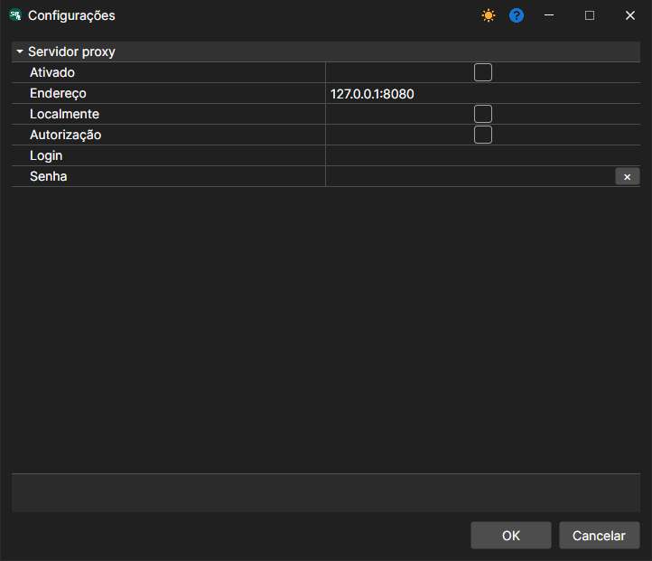

# Definições de rede

Menu **Arquivo \=\> Configurações de proxy**. (A opção **Servidor \=\> Configurações de rede** corresponde às definições do [modo servidor](../server_mode/settings.md).)

Permite configurar as definições de proxy.
