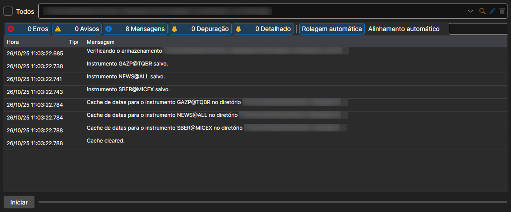

# Sincronização

Menu **Importar \=\> Sincronizar...**.

Permite recuperar os instrumentos a partir dos ficheiros descarregados.

A opção **Importar \=\> Criar índice** reconstrói o índice do armazenamento, ou seja, a lista de que dados contém e de que dias. O Hydra também reconstrói o índice por si só, com o intervalo definido nas definições gerais.
