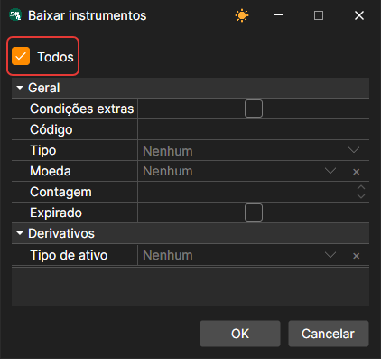
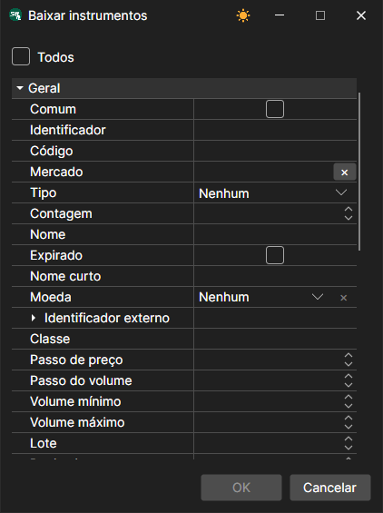
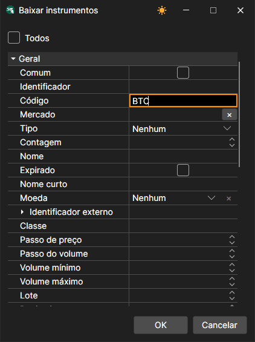
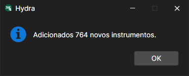
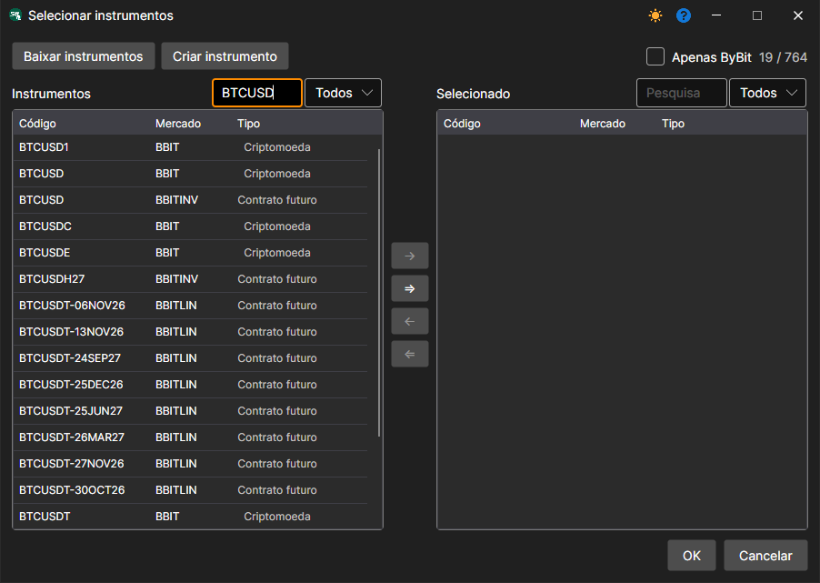
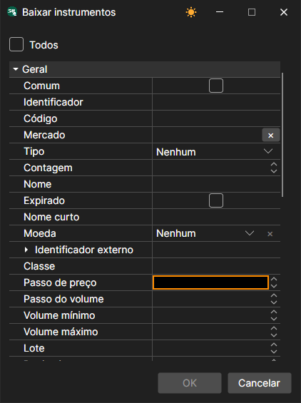
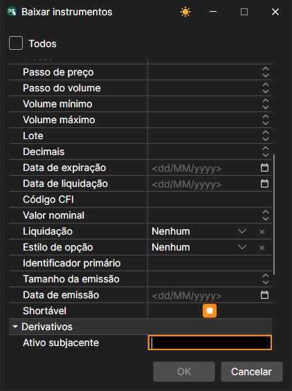

# Lista de instrumentos

Configuração do instrumento para descarregamento.

Para algumas fontes, é possível configurar o descarregamento dos instrumentos necessários.

Vejamos um exemplo de descarregamento de instrumentos a partir da fonte **ByBit**:

1. Clique em **Baixar instrumentos**. Por predefinição, está assinalada a opção **Todos**: serão descarregados todos os instrumentos da fonte.
2. Desmarque **Todos** e assinale **Condições extras**. Depois disso, será aberta uma lista de definições avançadas para o instrumento descarregado; a opção **Comum** volta à lista resumida.
3. É necessário descarregar os instrumentos cujo código contém BTC. Para isso, indicamos BTC no campo **Código** e clicamos em **OK**.

   Depois disso, o programa [Hydra](../../hydra.md) descarregará todos os instrumentos que correspondam aos parâmetros especificados e informará quantos deles são novos. 

A definição permite ao utilizador selecionar vários parâmetros para o instrumento descarregado. 

Assim, por exemplo, o utilizador pode selecionar:

- **Passo de preço e volume**
- **Volumes mínimo e máximo**
- **ID externo** 
- Para opções, permite definir o **Ativo subjacente** e o **Tipo de ativo** (tipo do instrumento subjacente). 

**Veja o [tutorial em vídeo](../videos/instruments_downloading.md)**
