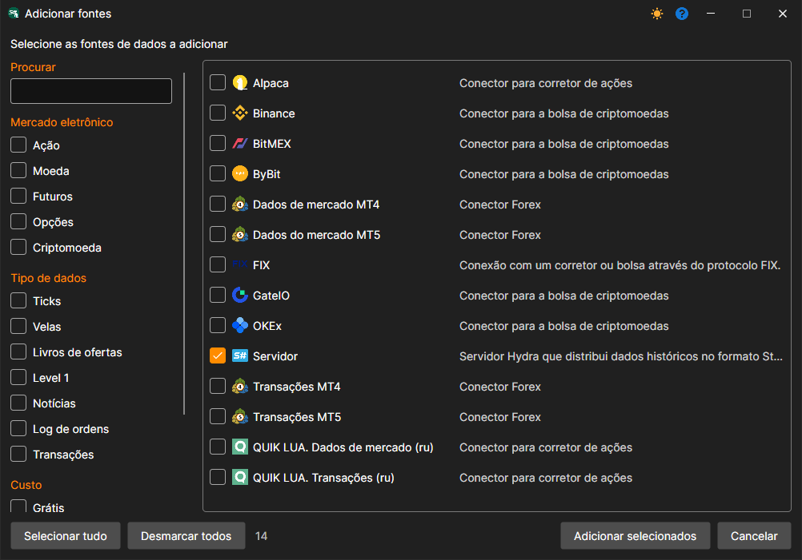
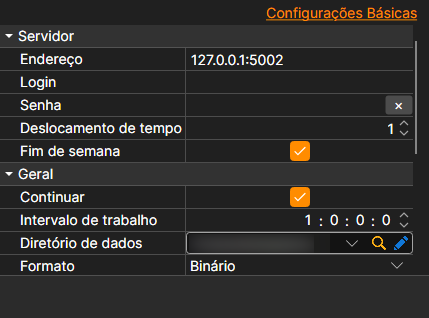

# Ligar um Cliente Hydra

No modo de servidor, é possível ligar outro programa Hydra, que atuará como cliente e descarregará dados para si próprio. Ao contrário da [Ligação através do Protocolo FIX](fix_fast_connectivity.md), os dados são transmitidos sob a forma de ficheiros no formato StockSharp. Isto torna a fonte adequada para transferir um grande volume de dados históricos.

Para a ligação utiliza-se a fonte **Servidor**: é preciso assinalá-la na janela que se abre com o botão **+** da secção **Fontes** e premir **Adicionar selecionados**.

**Definições**

**Servidor**

- **Endereço** - o endereço do servidor Hydra.
- **Início de sessão** - início de sessão (necessário se o servidor exigir autorização).
- **Palavra-passe** - palavra-passe (necessária se o servidor exigir autorização).
- **Desfasamento temporal** - um desfasamento temporal em dias relativamente à data atual, necessário para evitar o descarregamento de dados incompletos da sessão de negociação atual.
- **Fins de semana** - se se devem ignorar os fins de semana.

**Principal**

- **Continuar** - continuar a transferência a partir da última data transferida.
- **Intervalo de funcionamento** - intervalo de funcionamento.
- **Diretório de dados** - o diretório com dados onde serão guardados os ficheiros finais no formato [S#](../../api.md).
- **Formato** - o formato dos dados: BIN/CSV.
- **Máx. erros** - o número máximo de erros; ao atingi-lo, a tarefa será parada. Por predefinição, 0 - o número de erros é ignorado.
- **Título** - o título da tarefa.
- **Horário de trabalho** - horário de funcionamento da tarefa.
- **Validação** - o que fazer com os dados que não passam na validação: nada, eliminá-los ou parar a subscrição.

**Remotamente**

- **Ativado** - controlar a tarefa remotamente.
- **Notificação** - canal para o qual chegam as notificações sobre a tarefa.
- **Nível de registo** - que mensagens da tarefa são enviadas para o canal.

**Registo**

- **Nível de registo** - o nível de registo.
