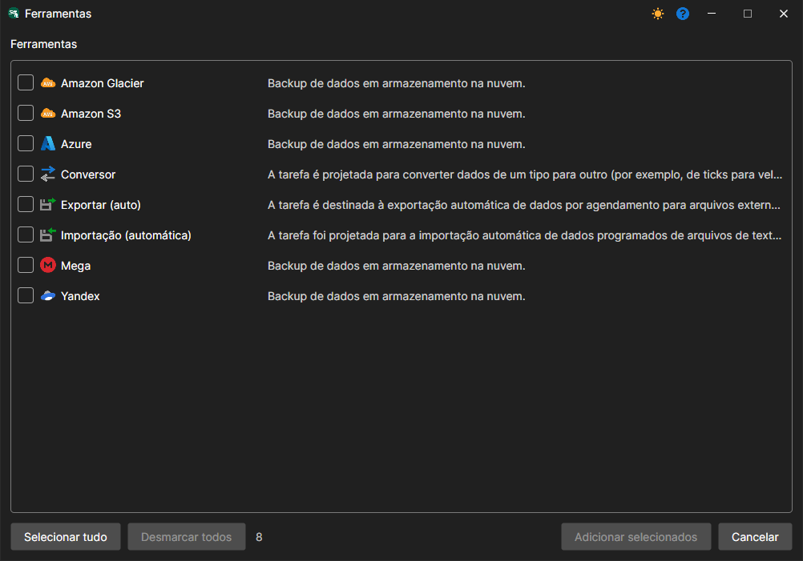

# Tarefas

A ferramenta é uma ação repetida a uma hora específica.

As ferramentas estão reunidas no grupo **Ferramentas** do painel **Tarefas** à esquerda (consulte [Interface do programa](user_interface.md)). O trabalho com ferramentas é igual ao trabalho com fontes - a ferramenta pode ser adicionada, eliminada, editada, ativada/desativada. Para adicionar a **Ferramenta**, no menu **Arquivo** selecione a opção **Ferramentas**. Surgirá uma janela correspondente, na qual pode selecionar a **Ferramenta** necessária...

Atualmente, existem quatro classes de tarefas no [Hydra](../hydra.md)

- [Importação (automática)](tasks/import_auto.md) - a tarefa consiste em importar dados a partir do formato CSV.
- [Conversor](tasks/converter.md) - a tarefa consiste em converter dados da bolsa em ticks, velas ou livros de ordens.
- [Exportação (automática)](tasks/export_auto.md) - a tarefa consiste em exportar velas para diferentes formatos.
- [Cópia de segurança](misc/backup.md) - a tarefa consiste em fazer uma cópia de segurança dos dados para o serviço na nuvem.
