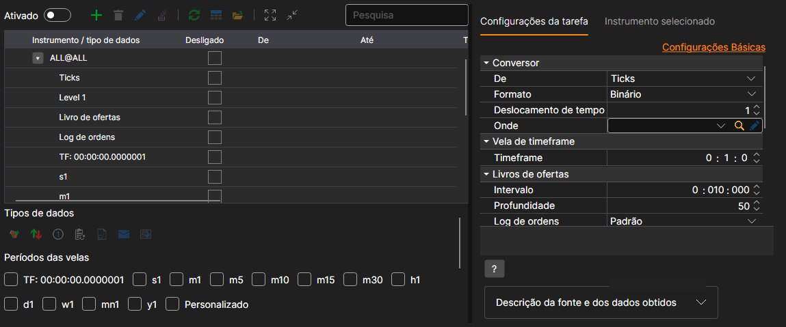
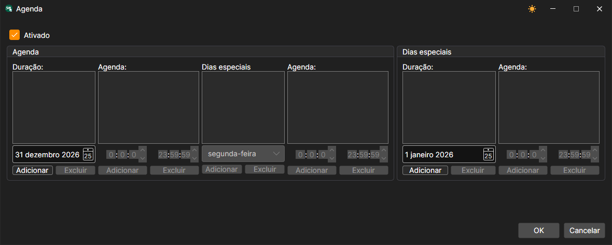
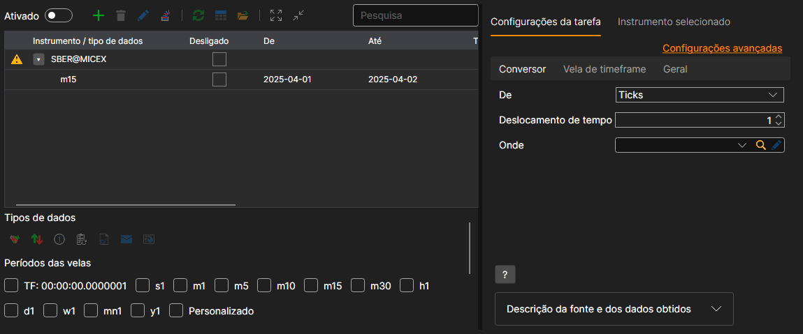
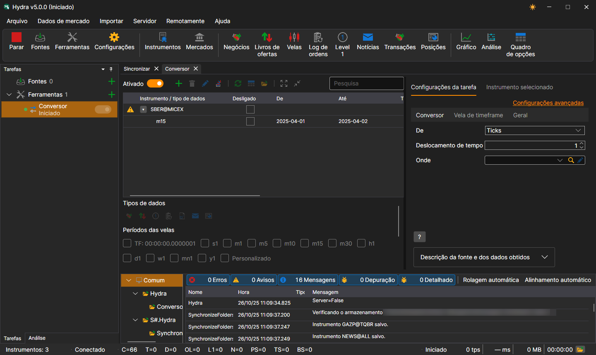
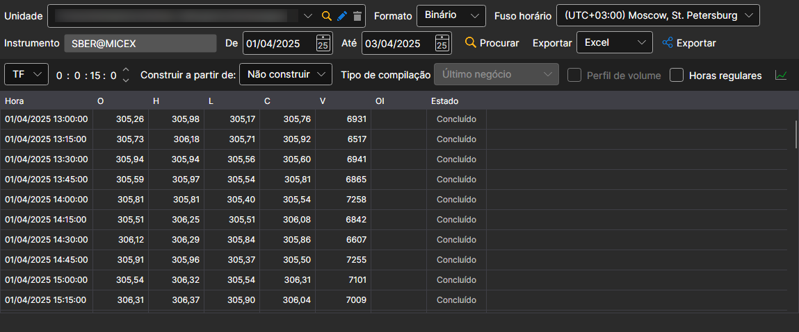

# Conversor

A tarefa converte dados da bolsa. Por exemplo, de registos de ordens para ticks ou de ticks para velas, etc.

A tarefa adiciona-se com o botão **Ferramentas**: na janela que se abre, é preciso assinalar o item **Conversor** e premir o botão **Adicionar selecionados**. As definições da tarefa estão divididas em separadores, e a ligação **Configurações avançadas** mostra-as todas numa única lista.

**Conversor**

- **Origem** - que tipo de dados será convertido.
- **Formato** - formato dos dados convertidos: BIN\/CSV.
- **Desfasamento temporal** - o desfasamento temporal em dias relativamente à data em que a tarefa foi iniciada. Isto impede a conversão de um dia incompleto. Se estiver configurada a conversão de dados em tempo real, o intervalo de atualização pode deixar o dia atual apenas parcialmente convertido. Utilize o desfasamento temporal para evitar isso.
- **Destino** - o diretório de dados onde os dados convertidos serão guardados.

**Vela de timeframe**

- **Timeframe** - período das velas a partir das quais é feita a conversão, se no campo **Origem** tiverem sido selecionadas velas.

**Livros de ordens**

- **Intervalo** - intervalo de geração dos livros de ordens.
- **Profundidade** - profundidade máxima da geração dos livros de ordens.
- **Registo de ordens** - como construir livros de ordens a partir do registo de ordens.

  **Por predefinição** serve na maioria dos casos. Se a ligação tiver o seu próprio formato de registo de ordens (por exemplo, **Plaza** na Bolsa de Moscovo), esse formato aparece na lista quando a ligação está estabelecida.

**Geral**

- **Continuar** - continuar a conversão a partir da última data convertida.
- **Intervalo de operação** - o intervalo de funcionamento.
- **Diretório de dados** - diretório de dados, de onde serão recebidos os dados para conversão.
- **Formato** - o formato dos dados que são convertidos: BIN\/CSV.
- **Máx. erros** - o número máximo de erros; ao atingi-lo, a tarefa será parada. Por predefinição, 0 - o número de erros é ignorado.
- **Cabeçalho** - Conversor.
- **Horário de trabalho** - horário de funcionamento da tarefa. 

**Registo**

- **Nível de registo** - o nível de registo.

Consideremos um exemplo de conversão de dados.

1. Aceda à tarefa **Conversor** e adicione um instrumento com o botão **+** por cima da tabela. 
2. Na janela que aparece, defina o tipo de dados que devemos receber durante a conversão e o período. O tipo de dados a partir do qual se faz a conversão define-se na opção **Origem**. Por exemplo, precisa de converter Ticks em velas com um período de 15 minutos.

   > [!TIP]
> IMPORTANTE\! O período de dados solicitado deve corresponder ao período disponível para conversão; caso contrário, os dados não serão convertidos. Nas definições, especifique o formato correto dos dados de origem para que corresponda ao formato dos dados que estão a ser convertidos.
3. Especifique os diretórios necessários. Desfasamento temporal. Intervalo de funcionamento.
4. Ativamos a tarefa com o interruptor **Ativado** e iniciamos a conversão com o botão **Iniciar**. 

Pode ver-se que os dados foram convertidos. [Vamos analisar](../working_with_data/view_and_export.md) os dados resultantes.

Esta função é semelhante a [obter os dados de mercado necessários](../working_with_data/any_market_data_types.md) a partir de outro tipo de dados.

**Veja o [tutorial em vídeo](../videos/converter_task.md)**
