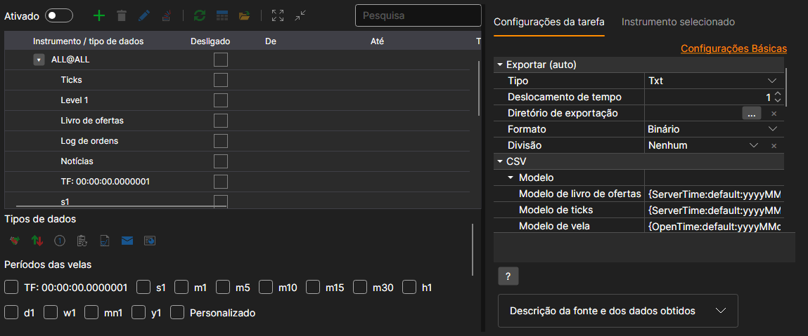
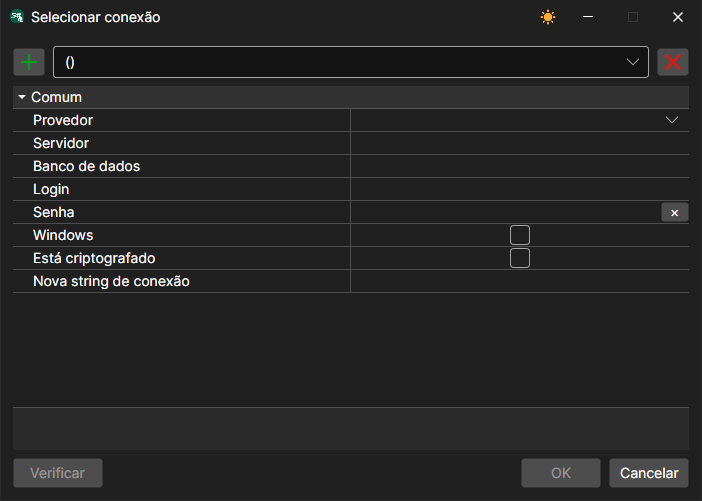
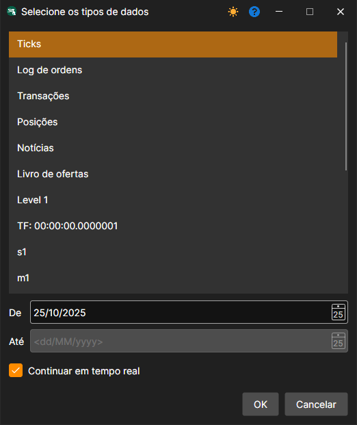
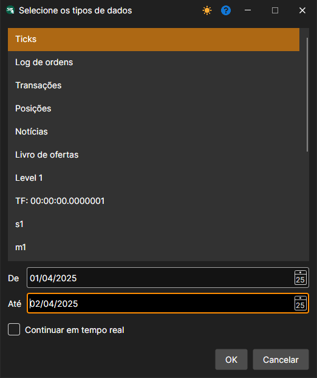
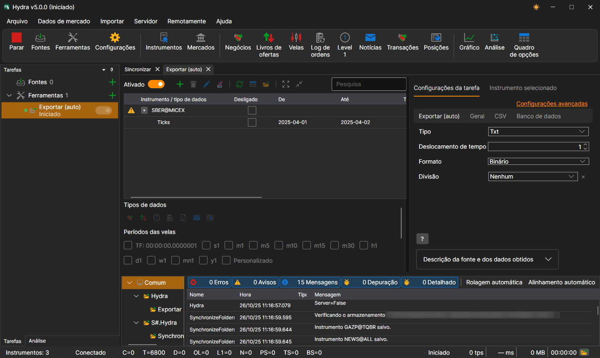

# Exportação (automática)

A tarefa exporta dados da bolsa para vários formatos: Excel, xml, sql, bin, Json ou txt.

A tarefa adiciona-se com o botão **Ferramentas**: na janela que se abre, é preciso assinalar o item **Exportar (auto)** e premir o botão **Adicionar selecionados**. As definições da tarefa estão divididas em separadores, e a ligação **Configurações avançadas** mostra-as todas numa única lista.



**Exportação (automática)**

- **Tipo** - tipo de exportação (formato).
- **Desfasamento temporal** - desfasamento temporal em dias.
- **Diretório de exportação** - diretório para onde os dados serão exportados. Se não for definido, os ficheiros são guardados no diretório de dados.
- **Formato** - formato dos dados.
- **Divisão** - tipo de divisão: por dias, meses ou anos.

**Base de dados**

- **Ligação** - ligação à base de dados. Utilizada no caso de exportação via SQL.
- **Pacote** - o tamanho do pacote de dados transmitido. Por predefinição, o tamanho é de 50 elementos. Utilizado no caso de exportação via SQL.
- **Unicidade** - verificar a unicidade dos dados na base de dados. Afeta o desempenho. Ativada por predefinição. Utilizada no caso de exportação via SQL.

> [!TIP]
> Ao utilizar exportação via SQL, é necessário definir a ligação à base de dados.

A janela de ligação abre-se com o botão da lupa do campo **Ligação**, e nela o botão **+** adiciona uma nova ligação:



- **Fornecedor** - definições do fornecedor.
- **Servidor** - endereço do servidor ou caminho para a base de dados.
- **Base de dados** - nome da base de dados. Não utilizado para SQLite.
- **Início de sessão** - início de sessão para aceder à base de dados. Não utilizado para acesso anónimo.
- **Palavra-passe** - palavra-passe para aceder à base de dados. Não utilizada para acesso anónimo.
- **Windows** - utilizar a conta atual do Windows para ligar à base de dados.
- **Está criptografado** - encriptar a ligação ao servidor.
- **Nova string de conexão** - string de ligação pronta a utilizar.

> [!TIP]
> Pode verificar a ligação à base de dados usando o botão **Verificar**.

**CSV**

- **Modelo** - modelos para cada tipo de dados exportados.
- **Cabeçalho** - o cabeçalho na primeira linha. Se for passada uma string vazia, o cabeçalho não será adicionado ao ficheiro.
- **Formato do nome do arquivo** - o formato para escrever o nome do ficheiro exportado.

**Geral**

- **Continuar** - continuar a exportação a partir da última data exportada.
- **Intervalo de operação** - o intervalo de funcionamento.
- **Diretório de dados** - diretório de dados de onde são retirados os dados exportados.
- **Formato** - o formato dos dados convertidos: BIN\/CSV.
- **Máx. erros** - o número máximo de erros; ao atingi-lo, a tarefa será parada. Por predefinição, 0 - o número de erros é ignorado.
- **Cabeçalho** - título da tarefa.
- **Horário de trabalho** - horário de funcionamento da tarefa. 

**Registo**

- **Nível de registo** - o nível de registo.

Consideremos um exemplo de exportação automática:

1. Selecione o instrumento com o botão **+** por cima da tabela.
2. Configure os dados de mercado que precisam de ser exportados.
3. Defina o período de exportação. Se estiver configurado o descarregamento de dados de mercado em tempo real, pode omitir a data de fim do período. Neste caso, os dados serão exportados em tempo real, de acordo com o intervalo de trabalho (atualização dos dados). 
4. Configuração de diretórios. Intervalo de funcionamento. Tipo de dados. Formato dos dados.
5. Ativamos a tarefa com o interruptor **Ativado** e iniciamos a exportação com o botão **Iniciar**.

Vamos ver os dados exportados. Os ticks de SBER@MICEX de 1 e 2 de abril, exportados para o tipo **Txt** com o modelo de ticks predefinido, estão no ficheiro `trades_SBER@MICEX_2025_04_01_2025_04_02.csv` e começam assim:

```
20250401;10:00:00.000000;15500000;305.26;88;Buy
20250401;10:00:09.000000;15500001;305.23;2;Sell
20250401;10:00:18.000000;15500002;305.20;48;Sell
20250401;10:00:27.000000;15500003;305.22;46;Buy
20250401;10:00:36.000000;15500004;305.28;105;Sell
```

**Veja o [tutorial em vídeo](../videos/export_task.md)**
