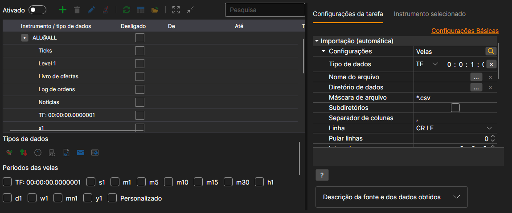
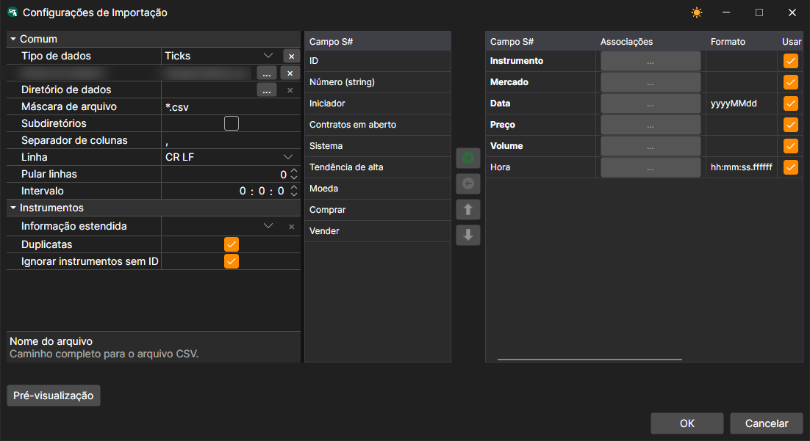
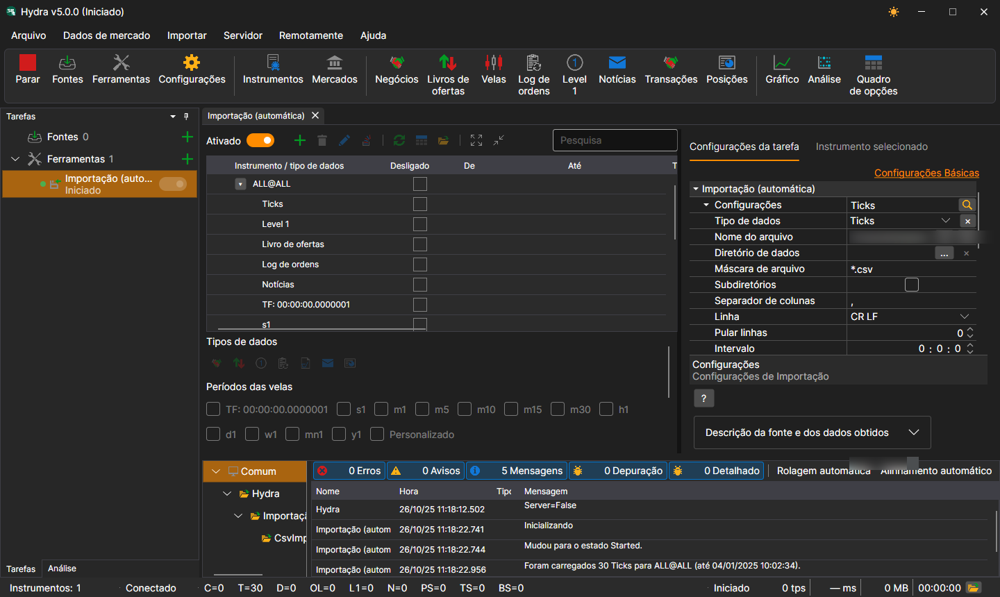

# Importação (automática)

A tarefa executa a importação automática de dados da bolsa a partir de ficheiros no diretório especificado, de acordo com a máscara de ficheiro especificada.

A tarefa adiciona-se com o botão **Ferramentas**: na janela que se abre, é preciso assinalar o item **Importação (automática)** e premir o botão **Adicionar selecionados**. A ligação **Configurações avançadas** mostra todas as definições da tarefa numa única lista.

O que importar e de onde define-se na linha **Definições**. O botão da lupa desta linha abre uma janela na qual, além dessas mesmas definições, as colunas do ficheiro são associadas aos campos do S#, tal como no separador [Importação](../importing.md):

**Definições**

- **Tipo de dados** - tipo dos dados importados.
- **Nome do ficheiro** - caminho completo para o ficheiro.
- **Diretório de dados** - diretório com os ficheiros, se não for importado um único ficheiro, mas todos os ficheiros adequados do diretório.
- **Máscara de ficheiro** - máscara de ficheiro utilizada ao analisar o diretório. Por exemplo, candles\*.csv.
- **Subdiretórios** - incluir subdiretórios.
- **Separador de colunas** - separador de colunas. A tabulação é indicada por TAB.
- **Linha** - fim de linha no ficheiro: CR LF, LF ou CR.
- **Pular linhas** - o número de linhas a ignorar desde o início do ficheiro (se contiverem metainformação).
- **Intervalo** - a frequência de atualização dos dados.
- **Informação alargada** - guardar campos importados alargados no armazenamento de informação alargada.
- **Duplicados** - se instrumentos duplicados devem ser atualizados caso já existam.
- **Ignorar sem ID** - ignorar instrumentos sem identificador.

**Geral**

- **Continuar** - continuar a importação a partir da última data importada.
- **Intervalo de operação** - o intervalo de funcionamento.
- **Diretório de dados** - diretório de dados, de onde serão recebidos os dados para conversão.
- **Formato** - o formato dos dados convertidos: BIN\/CSV.
- **Máx. erros** - o número máximo de erros; ao atingi-lo, a tarefa será parada. Por predefinição, 0 - o número de erros é ignorado.
- **Cabeçalho** - título da tarefa.
- **Horário de trabalho** - horário de funcionamento da tarefa. 

**Registo**

- **Nível de registo** - o nível de registo.

Consideremos um exemplo de importação automática de ticks. No ficheiro `ticks.csv`, cada negócio está escrito numa linha do tipo `GAZP,TQBR,20250401,128.58,74,10:00:02.000000`: instrumento, mercado, data, preço, volume e hora.

1. Com o botão da lupa na linha **Definições**, abrimos a janela de definições da importação.
2. Selecionamos o tipo de dados **Ticks** e indicamos o caminho para o ficheiro no campo **Nome do ficheiro**.
3. Acrescentamos aos campos do S# o campo **Hora**: os campos obrigatórios (instrumento, mercado, data, preço e volume) já estão na ordem em que as colunas aparecem no ficheiro, e a hora acrescenta-se a seguir a eles. Premimos **OK**.
4. Ativamos a tarefa com o interruptor **Ativado** e iniciamos a importação com o botão **Iniciar**. 
