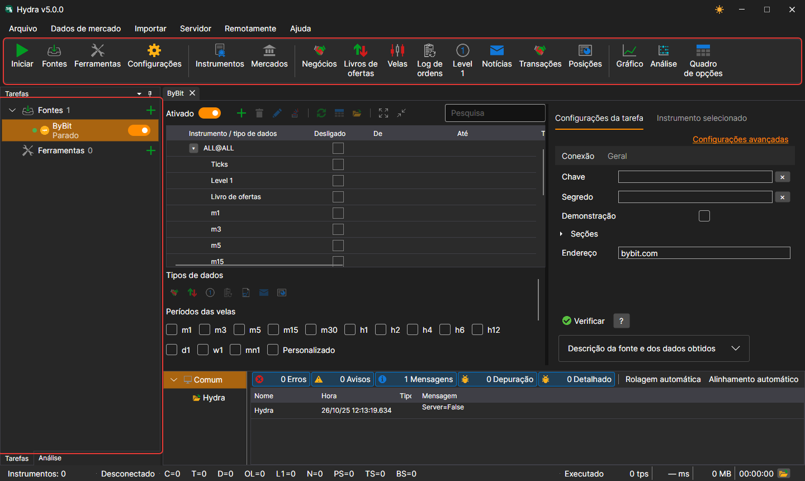
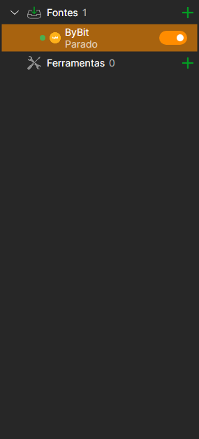
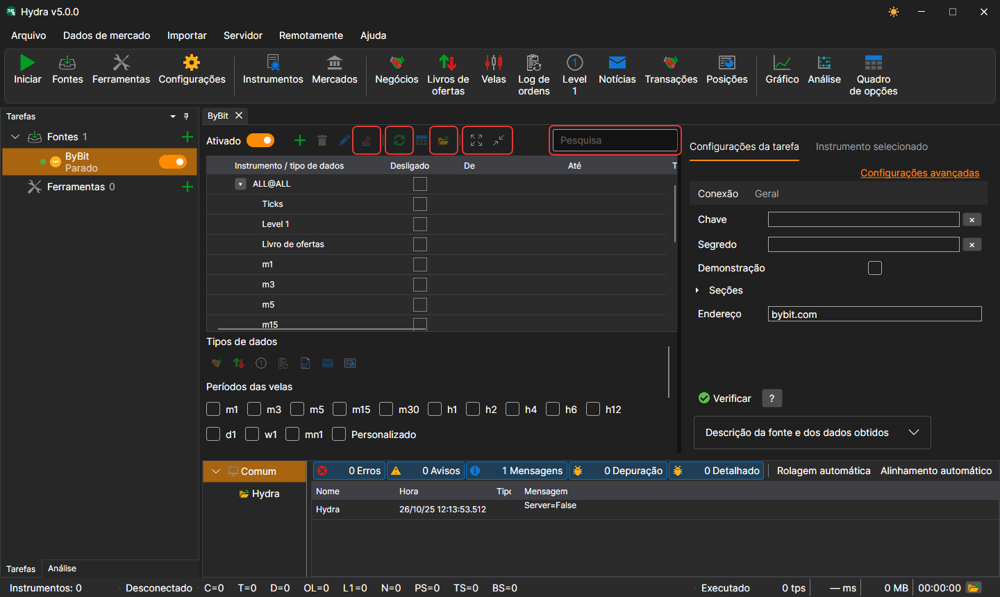

# Interface do programa

A janela do [Hydra](../hydra.md) é composta pelo menu, pela barra de comandos por baixo dele, pelos painéis **Tarefas** e **Análise** à esquerda, pelo painel **Registros** em baixo e pelos documentos ao centro: painéis de fontes, de ferramentas e de dados de mercado. Na parte inferior da janela está a barra de estado.

## Menu

- **Arquivo** — adição de [fontes](data_sources.md) e ferramentas, [definições gerais](misc/settings.md), [definições de proxy](misc/network_settings.md), [reposição das definições](misc/settings_reset.md) e saída.
- **Dados de mercado** — painéis para ver os dados de mercado do armazenamento: instrumentos, mercados, negócios, livros de ordens, velas, registo de ordens, Level 1, notícias, transações, posições, bem como o [gráfico](working_with_data/chart.md), a análise e o quadro de opções.
- **Importar** — [importação](importing.md) de dados a partir de ficheiros, [sincronização](misc/synchronization.md) do armazenamento e construção do seu índice.
- **Servidor** — [modo de servidor](server_mode/settings.md): ativação, definições de rede, utilizadores e subscrições dos clientes.
- **Remotamente** — controlo remoto do Hydra através do bot do Telegram ([Painel de Controlo](../telegram_services/control_panel.md)) e a janela **Canais** com a lista de canais do Telegram para os quais o Hydra envia mensagens.
- **Ajuda** — mudança do tema, contacto com a equipa da StockSharp, comunicação de um problema, documentação e a janela **Sobre o programa**.

No macOS, o menu passa para a barra de menus do sistema.

## Barra de comandos

Por baixo do menu está a barra de comandos com as ações mais frequentes: **Iniciar / parar todas as tarefas**, adição de fontes e ferramentas, definições; os painéis **Instrumentos** e **Mercados**; os painéis de dados de mercado (negócios, livros de ordens, velas, registo de ordens, Level 1, notícias, transações e posições); **Gráfico**, **Análise** e **Quadro de opções**.

## Tarefas

No painel **Tarefas** à esquerda, as tarefas estão organizadas nos grupos **Fontes** e **Ferramentas**. Cada grupo mostra o número de tarefas e um botão **+** que adiciona uma nova. Cada tarefa tem um ponto (verde se a tarefa estiver ativada), um ícone, o nome, uma linha com o seu estado atual e um interruptor; o ícone do relógio indica que a tarefa tem um horário de trabalho definido. Um duplo clique abre o painel da tarefa, e um clique direito, um menu com as opções **Abrir** e **Excluir**.

Enquanto não houver nada aberto no centro da janela, aí é apresentado o ecrã de boas-vindas com os botões **Adicionar fontes** e **Adicionar ferramentas**.

Enquanto decorre um trabalho longo, por exemplo, a leitura de um armazenamento grande ou a adição de uma fonte, a janela fica coberta por uma camada semitransparente com a descrição do que está a ser feito.

## Painel da tarefa

Por cima da tabela de instrumentos da fonte estão a pesquisa, o interruptor **Ativado**, os botões para adicionar, eliminar e alterar instrumentos, **Adicionar ALL@** (todos os instrumentos da fonte de uma só vez), a sincronização de datas, a passagem para os dados e para a pasta do armazenamento, e recolher e expandir as linhas. No separador de definições há um botão para verificar a ligação e a descrição da fonte, e no separador **Instrumento selecionado**, as propriedades do instrumento selecionado na tabela.

## Barra de estado

Na parte inferior da janela vê-se quantos instrumentos há no armazenamento, se o Hydra está ligado, quantos dados de cada tipo foram recebidos desde o arranque, em que está o programa ocupado neste momento e o último aviso ou erro do registo. O botão da pasta abre a pasta de registos. Enquanto decorre uma operação longa (a leitura de um armazenamento grande, a adição de uma fonte), a janela fica coberta por uma camada com a descrição do trabalho.

## Ver também

[Primeiro arranque](first_start.md)

[Fontes de dados](data_sources.md)
