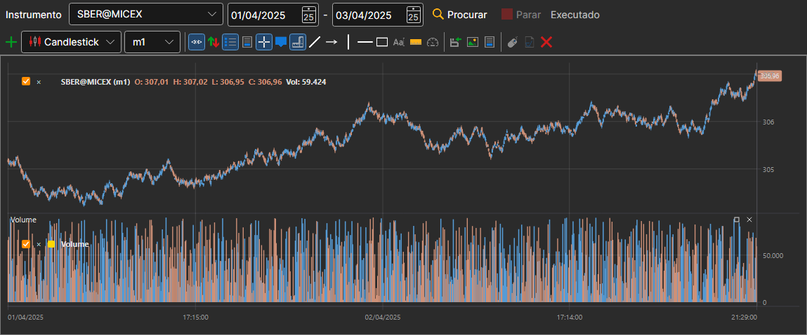

# Gráfico

O painel **Gráfico** mostra as velas de qualquer instrumento que exista no armazenamento. Abre-se com a opção **Dados de mercado → Gráfico** ou com o botão **Gráfico** da barra de comandos.

Na linha por cima do gráfico escolhem-se o **Instrumento** e o período (a data de início e a de fim) e depois prime-se **Procurar**. As velas são lidas do armazenamento e desenhadas à medida que são lidas; **Parar** interrompe a leitura, e a linha junto aos botões mostra como decorre o trabalho.

Por baixo há um gráfico completo, igual ao do [Terminal](../../terminal/user_interface/components/chart.md): com barra de botões, estilos de velas, indicadores e desenho. Ao gráfico pode ser adicionado um [indicador](view_and_export/indicators.md), e o botão **Parar desenho** interrompe o desenho prolongado de um período grande.

## Ver também

[Geração de velas](candles_generation.md)

[Visualizar dados de mercado](view_and_export.md)
