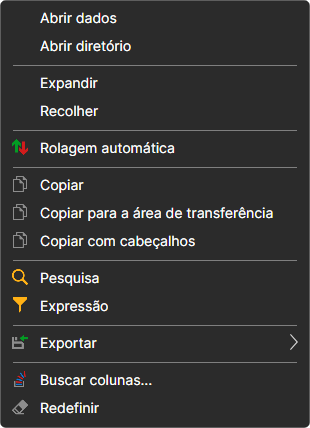
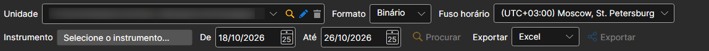
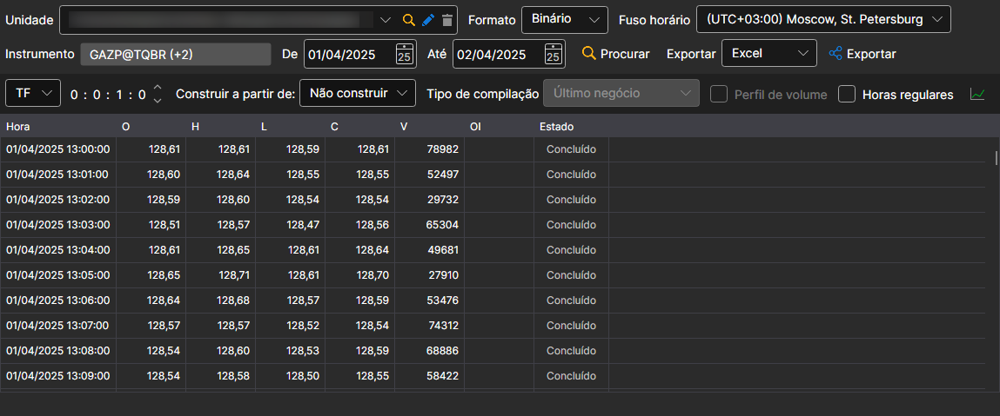
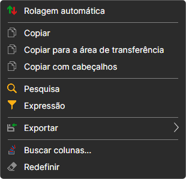

# Visualizar e exportar

Os dados recebidos pelo [Hydra](../../hydra.md) podem ser visualizados em painéis especiais.

Para isso, no menu **Dados de mercado** selecione uma das seguintes opções: [Ticks](view_and_export/ticks.md), [Livros de ordens](view_and_export/order_books.md), [Geração de velas](candles_generation.md), [Registo de ordens](view_and_export/order_log.md), [Level 1](view_and_export/level_1_.md), [Notícias](view_and_export/news.md), [Transações](view_and_export/transactions.md), [Painel de opções](view_and_export/option_desk.md), [Indicadores](view_and_export/indicators.md), [Posições](view_and_export/positions.md).

O painel com os dados de uma tarefa também se abre a partir da sua tabela de instrumentos: com um duplo clique no tipo de dados ou com a opção **Abrir dados** do menu de contexto, como mostrado na figura.

Cada painel contém uma interface geral das definições, como se segue:

- Na linha superior indicam-se o armazenamento de dados de mercado (**Unidade**), o seu **Formato** (binário ou CSV) e o **Fuso horário** em que a hora é apresentada.
- Na segunda linha escolhem-se os instrumentos e o período para o qual os dados serão solicitados. Ao clicar no botão **Selecionar instrumento**, aparecerá a janela de seleção de instrumentos, na qual pode selecionar um ou vários instrumentos. Se forem selecionados vários instrumentos, durante a exportação posterior para Excel ou CSV o programa ordenará automaticamente os dados dos diferentes instrumentos para ficheiros diferentes.
- Os dados encontrados são carregados na tabela em partes de mil linhas: a parte seguinte carrega-se sozinha quando a tabela é deslocada até ao fim, pelo que é possível avançar o que se quiser sem esperar que todo o período seja carregado. A ordenação por coluna ordena as linhas já carregadas, e a exportação com os botões do painel escreve todos os dados do período selecionado, e não apenas os carregados.
- Se os dados tiverem sido recebidos de origens cujo fuso horário não corresponda ao fuso horário atual, pode ajustar o fuso horário. Depois da construção, os dados serão mostrados no fuso selecionado pelo utilizador. 
- Como várias origens não oferecem a possibilidade de descarregar alguns dados, o programa disponibiliza o campo [Construir a partir de](any_market_data_types.md). Usando este campo, o utilizador pode construir dados de mercado a partir de outro tipo de dados de mercado. A mesma função pode ser usada para construir dados de mercado sem descarregamento adicional, usando como base dados já existentes.
- Depois de selecionar os parâmetros acima, deve clicar no botão **Procurar** . Enquanto decorre a pesquisa ou a exportação, por baixo das linhas de definições é apresentado o seu progresso e o botão **Parar**. Quando a exportação termina, aparece aí o botão **Abrir ficheiro** ou **Abrir pasta** com o seu resultado.

O menu de contexto da tabela de valores permite ativar o deslocamento automático, copiar as linhas selecionadas para a área de transferência, procurar um valor, filtrar as linhas com uma expressão, exportar a tabela para um ficheiro, para a área de transferência ou para impressão, escolher as colunas apresentadas e repor a sua disposição.

