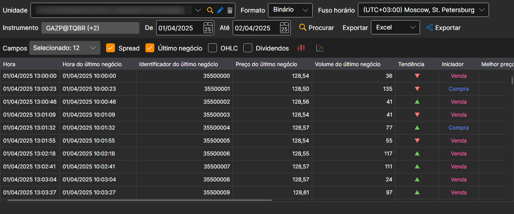
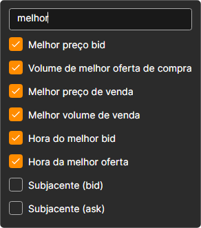

# Level 1 

Na janela que aparece, selecione os instrumentos, o intervalo temporal necessário e clique no botão :

A lista **Campos** define que valores de Level 1 são apresentados na tabela e incluídos na exportação. Assinale os campos necessários na lista pendente; a linha de pesquisa no topo da lista deixa apenas os campos cujo nome contém o texto escrito:

Os valores recebidos podem ser [exportados para o formato necessário](../export_data.md).
