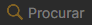
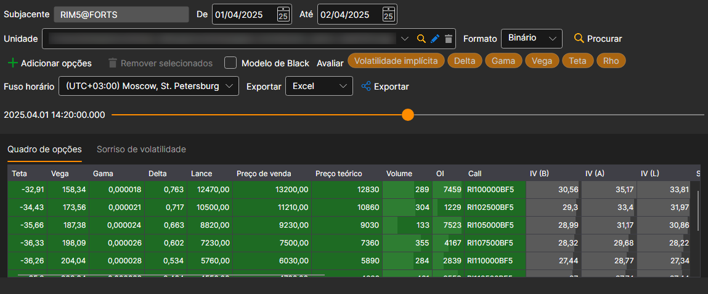
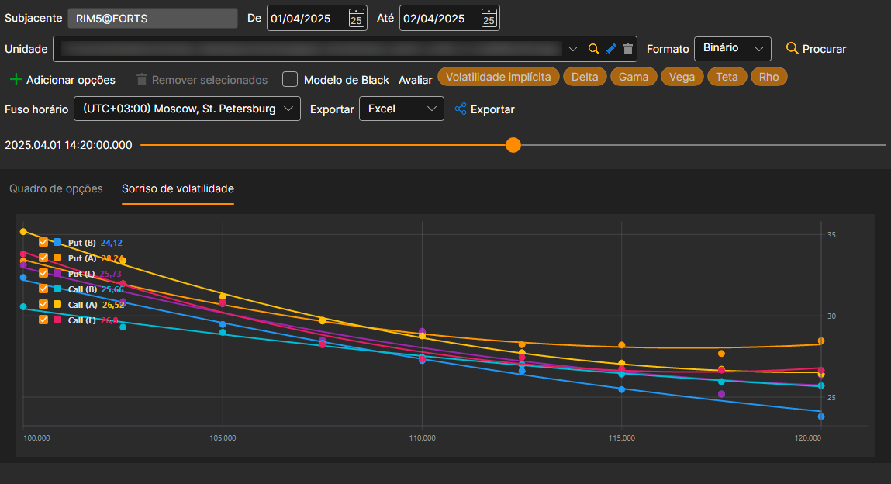

# Painel de opções

Na janela que aparece, selecione o ativo subjacente: as suas opções são adicionadas sozinhas ao quadro, e o intervalo temporal ajusta-se ao período para o qual existem dados no armazenamento. Com o botão **Adicionar opções** pode adicionar outras opções e com o botão **Remover selecionados**, retirar as que estão a mais. Em seguida, clique no botão :

Se não houver histórico das gregas, mas existirem dados sobre o spread, as principais gregas (Delta, Gamma, Vega, Theta, Rho, volatilidade implícita) podem ser calculadas: para isso, é necessário assinalá-las no campo **Avaliar**. A volatilidade é calculada a partir do preço de compra, do de venda e do do último negócio, e as restantes gregas, a partir da volatilidade do ponto médio do spread.

O controlo deslizante por cima do quadro leva-o a qualquer momento do histórico carregado; à esquerda do controlo é apresentada a hora desse momento. Quando o controlo chega ao último momento carregado, carrega-se a parte seguinte do histórico.

Para ver o **Sorriso de volatilidade**, é necessário ir ao separador **Sorriso de volatilidade**.

Os valores calculados podem ser [exportados para o formato necessário](../export_data.md).
