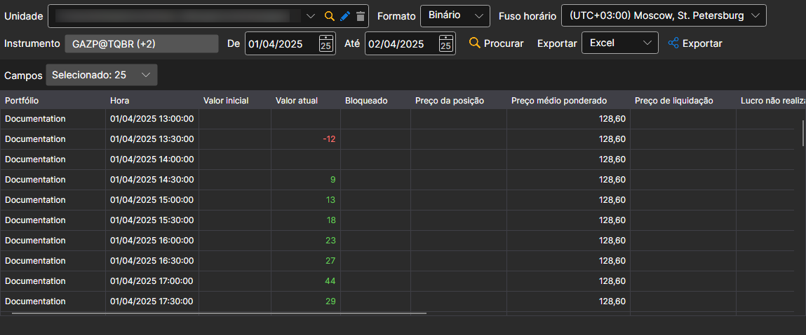

# Posições

Na janela que aparece, selecione os instrumentos, o intervalo temporal necessário e clique no botão :

A lista **Campos** define que valores da posição são apresentados na tabela e incluídos na exportação.

Os valores recebidos podem ser [exportados para o formato necessário](../export_data.md).
