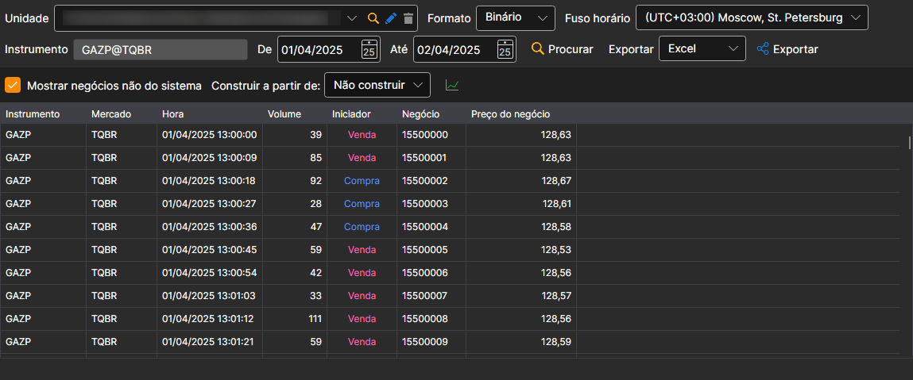

# Ticks

Na janela que aparece, selecione os instrumentos, o intervalo temporal necessário e clique no botão :

Para descarregar negócios não sistémicos, deve assinalar a caixa **Mostrar negócios não do sistema**.

Os valores recebidos podem ser [exportados para o formato necessário](../export_data.md).
