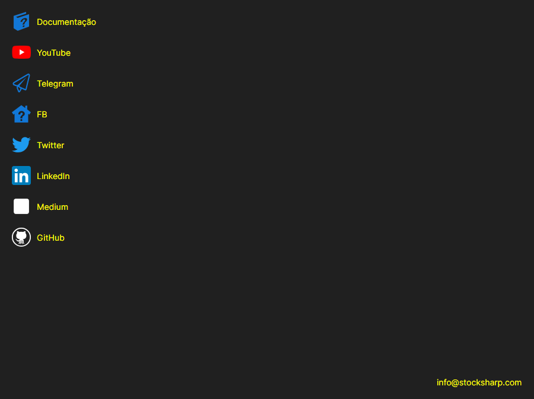

# Ajuda

A página **Ajuda** abre-se com o separador com o mesmo nome na parte superior da janela do [Installer](../installer.md).

A página reúne as ligações mais procuradas a partir do [Installer](../installer.md): **Documentação**, **YouTube**, **Telegram** (chat de suporte), **Twitter**, **Dzen** e **GitHub**. A ligação abre-se no navegador predefinido do sistema. Na parte inferior da página está o endereço de e-mail para o qual se pode escrever à empresa.

É possível comunicar um problema com o botão do título da janela, que existe em qualquer página. Se o [Installer](../installer.md) não se comportou como esperado, anexe à mensagem as entradas da página [Registros](logs.md): nelas vê-se o que aconteceu exatamente.

## Ver também

[Registros](logs.md)
