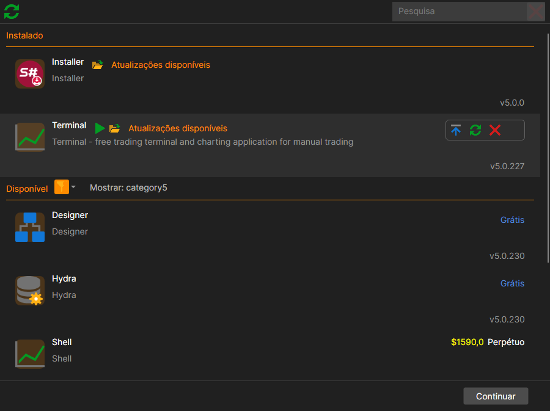
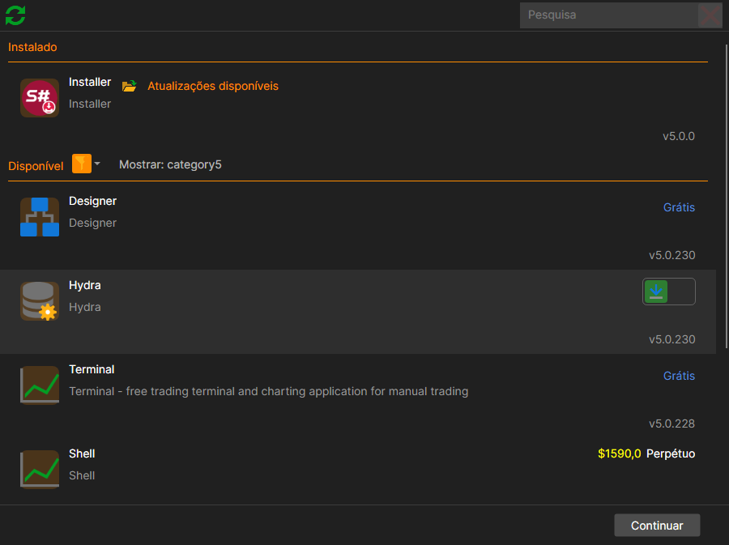
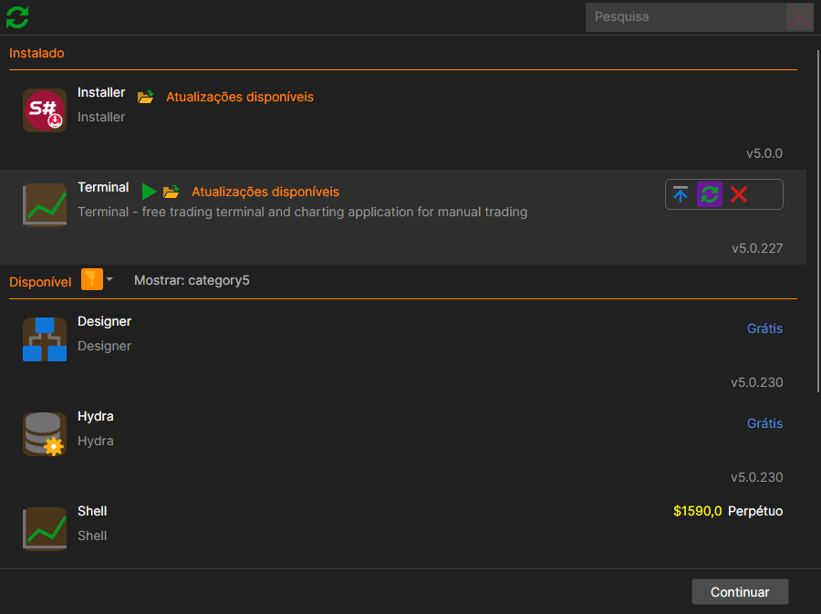
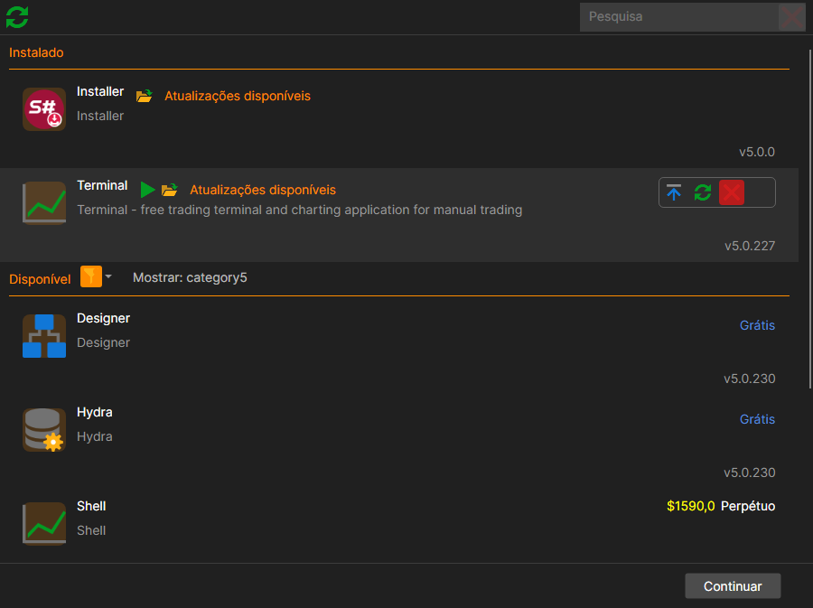
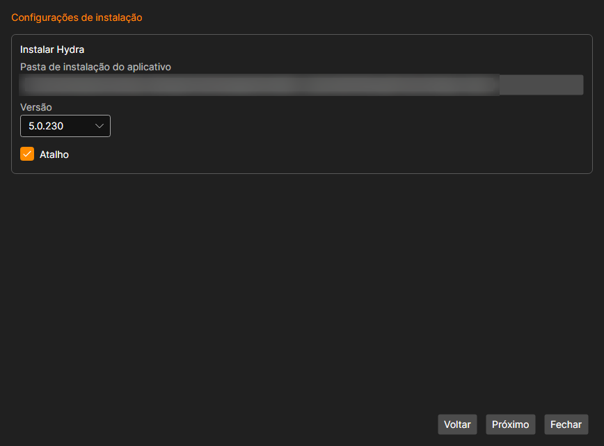

# Instalar e remover aplicações

Tudo o que o [Installer](../installer.md) faz com os programas é feito no separador **Aplicativos**: a instalação, a atualização, a reparação e a remoção. A ação é assinalada no produto da lista, e todas as assinaladas são executadas de uma só vez.

## Catálogo

A lista está dividida em duas partes: **Instalado**, o que já está neste computador, e **Disponível**, o que é possível instalar. Se uma parte não tiver nada, no seu lugar aparece **Vazio**.

Para encontrar o que precisa, servem:

- o campo **Pesquisa** por cima da lista: a lista reduz-se à medida que escreve, e a cruz ao lado repõe-na por inteiro;
- o funil junto ao título **Disponível**: filtro por tipo de produto; o botão **Todos** remove-o;
- o botão com a seta circular no canto superior esquerdo, **Verificação forçada de atualizações**: pergunta à loja se saiu algo novo, sem esperar pela próxima verificação.

Na linha de um produto instalado é apresentada a sua versão e, se tiver saído uma nova, o texto **Atualizações disponíveis**.

## Contrato de licença

Na parte inferior da janela há uma caixa de aceitação com uma ligação para o texto do contrato. Enquanto não for aceite, o botão **Continuar** continua indisponível, seja o que for que esteja assinalado. A aceitação é dada uma única vez e é registada no servidor: depois disso, a caixa deixa de ser apresentada e não é possível retirá-la.

## O que fazer com o produto

À direita de cada linha há um conjunto de botões, dos quais se escolhe um. Os que existem dependem do produto:

| Botão | Quando está disponível | O que faz |
|---|---|---|
| **Instalar** | o produto não está instalado | instala-o |
| **Atualizar** | está instalado e saiu uma nova versão | atualiza-o |
| **Reparar** | está instalado | volta a instalá-lo por cima, sem mexer nas definições |
| **Remover** | está instalado | remove-o |
| **Pular** | sempre | não fazer nada com este produto |

Um produto não instalado tem uma única opção, instalá-lo:

Um instalado, a reparação:

e a remoção:

O botão **Continuar** no canto inferior direito fica ativo assim que for assinalada pelo menos uma ação. É possível assinalar vários produtos de uma só vez, por exemplo, atualizar um e remover outro. Quando tudo estiver assinalado, prima **Continuar** no canto inferior direito.

## Assistente

Em seguida, em vez da lista, a janela mostra um assistente de três passos.

1. **Aplicativos**: o que vai ser feito exatamente. Verifique a lista e prima **Continuar**.
2. **Configurações de instalação** 

   Cada ação tem aqui as suas próprias definições:

   - **Pasta de instalação do aplicativo**: escolhe-se com um botão. **IMPORTANTE\!** A pasta tem de estar vazia.
   - **Versão** e **Destinatário**: que versão é instalada e para quem.
   - **Atalho**: criar um atalho no ambiente de trabalho.
   - **Remova a pasta de dados do aplicativo**: só ao remover; apagar juntamente com o programa as suas definições e os dados transferidos. Sem esta caixa, são mantidos.
   - **Plugins**: para os programas que os suportam, que conectores instalar juntamente com o produto.
   - **Instalar parâmetros principais do aplicativo**: num produto com plugins, é possível desmarcar esta caixa e trabalhar apenas com os plugins, sem mexer no próprio programa.

   Prima **Próximo**.
3. **As seguintes ações serão executadas**: a última verificação. Prima **Executar**.

Enquanto decorre o trabalho, é apresentado **Em andamento. Por favor, aguarde...**; no fim, **Executado**. O botão **Fechar** volta à lista; **Voltar**, em qualquer passo, leva ao anterior.

Se algo correr mal, o texto do erro é apresentado diretamente no assistente, e os detalhes, na página [Registros](logs.md).

**Veja o [tutorial em vídeo](videos/install_and_remove_apps.md)**

## Conteúdo recomendado

[Atualizar aplicações](update_apps.md)

[Registros](logs.md)
