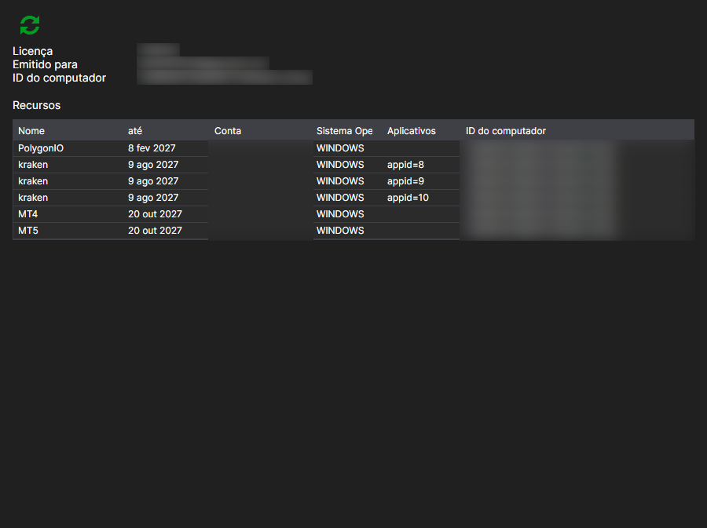

# Licenças

A página **Licenças** abre-se com o separador com o mesmo nome na parte superior da janela do [Installer](../installer.md) e está disponível depois de iniciar sessão na conta.

Aqui vê-se que licença foi emitida para esta conta e a que dá direito.

- **Emitida para**: em nome de quem está a licença e a que computador está associada: **Identificador do disco** e **Sistema operativo**. Com esta associação, o servidor decide se a licença é válida no computador atual.
- **Válida até**: data de expiração.
- **Produtos**: programas abrangidos pela licença.
- **Funcionalidades**: o que é permitido exatamente: ligações a mercados, número de instrumentos, acesso ao código-fonte, etc.

O botão **Atualizar licença** volta a pedir os dados ao servidor. Faz sentido premi-lo depois de uma compra ou de uma renovação: o [Installer](../installer.md) lê a licença ao iniciar sessão, e uma alteração feita mais tarde no site não aparece sozinha na janela.

Se não houver licença, a página indica-o. É possível obtê-la na página [Tarifas](tariffs.md).

## Ver também

[Tarifas](tariffs.md)
