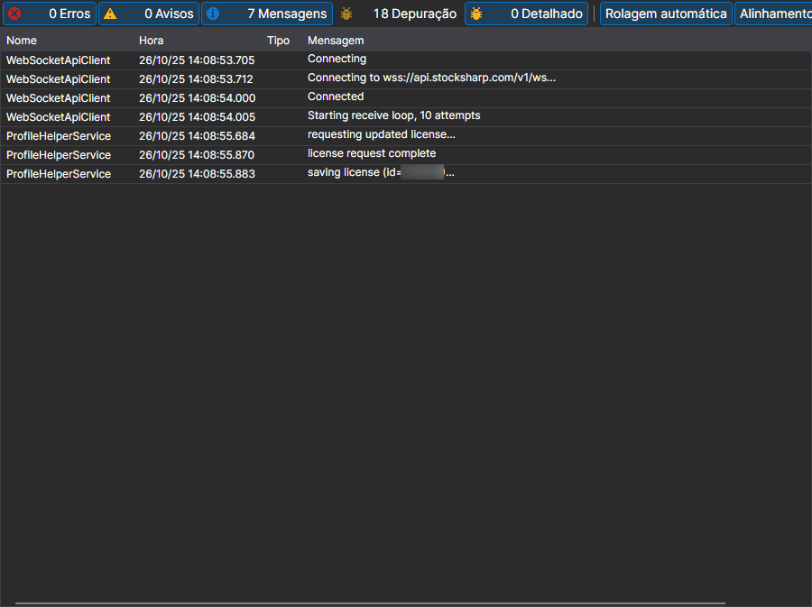

# Registros

A página **Registros** abre-se com o separador com o mesmo nome na parte superior da janela do [Installer](../installer.md).

Aqui o [Installer](../installer.md) escreve o que fez: a que servidor se dirigiu, que pacotes transferiu, onde instalou e onde parou. É o primeiro sítio para onde olhar se a instalação ou a atualização terminou com um erro.

Cada entrada contém a hora, o nível (erro, aviso, mensagem) e o texto. O nível de detalhe do registo define-se com o parâmetro **Registro** da página [Configurações](settings.md): ao contactar o suporte, convém aumentá-lo e repetir a ação que falhou; assim, no registo fica a causa e não apenas o facto do erro.

## Ver também

[Configurações](settings.md)
