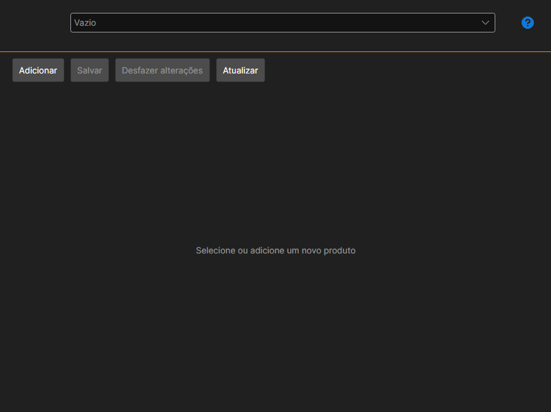

# Meus produtos

A página **Meus produtos** abre-se com o separador com o mesmo nome na parte superior da janela do [Installer](../installer.md) e está disponível depois de iniciar sessão na conta.

A página destina-se a quem publica os seus próprios produtos na [loja](https://stocksharp.com/pt/store/): robôs, indicadores, conectores. Um comprador não precisa dela: a instalação e a atualização estão descritas nas secções [Instalar e remover aplicações](install_and_remove_apps.md) e [Atualizar aplicações](update_apps.md).

## Ficha do produto

O produto escolhe-se na lista da parte superior; o botão **Adicionar** cria um novo.

- **Nome** e **Descrição**: o que o comprador verá na loja.
- **Identificador do pacote Nuget**: é com este nome que o pacote é publicado no NuGet. Ao lado é apresentado como ficará o nome completo.
- **Tipo de conteúdo** e **Área**: o que é o produto e onde é utilizado.
- **Categorias**: secções da loja nas quais o produto ficará visível.
- **Ligação para a documentação** e **Ligação para o código-fonte**: opcionais.
- **Ícone**: escolhe-se com um botão; é o mesmo que o comprador vê na lista do [Installer](../installer.md).

## Preço

Define-se separadamente: único (**Permanente**), **Por mês** e **Por ano**, mais o preço de renovação. Um preço não preenchido significa que essa forma de compra não existe.

## Acesso

A lista de utilizadores define a quem o produto fica visível além da loja: procure o utilizador e adicione-o. Assim se distribui o acesso, por exemplo, dentro de uma equipa.

## Gravação e publicação

**Salvar** grava as alterações, **Cancelar alterações** volta ao último estado gravado e **Atualizar** volta a ler a lista a partir do servidor.

**Publicar** envia o produto para revisão. Até ser aprovado, a página mostra que o produto ainda não foi aprovado, e a lista de erros na parte inferior enumera o que é preciso preencher ou corrigir; enquanto não estiver vazia, a publicação não é feita.

## Ver também

[Licenças](licenses.md)
