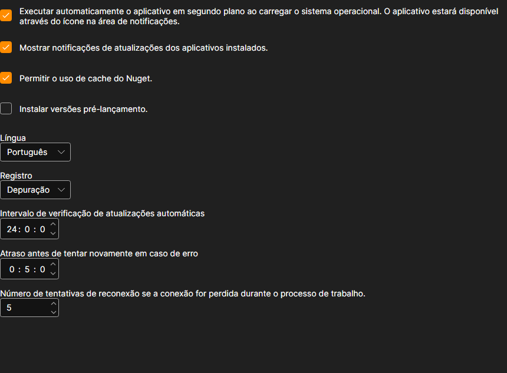

# Configurações

A página **Configurações** abre-se com o separador com o mesmo nome na parte superior da janela do [Installer](../installer.md).

## O que se pode alterar aqui

- **Iniciar automaticamente a aplicação em segundo plano ao arrancar o sistema operativo.** O [Installer](../installer.md) arranca com o Windows e fica na área de notificação, de onde tem de ser fechado: a cruz da janela não desliga o programa.
- **Mostrar notificações de atualizações dos aplicativos instalados.** Sem esta caixa, o [Installer](../installer.md) continua a verificar as atualizações, mas em silêncio: só é possível vê-las na página de aplicações. Para ver como é, consulte [Atualizar aplicações](update_apps.md).
- **Permitir o uso de cache do Nuget.** Os pacotes já transferidos neste computador são lidos do disco e não da rede. Acelera a reinstalação; desativa-se quando é preciso transferir o pacote de novo com garantia.
- **Instalar versões pré-lançamento.** Além das versões normais, são propostas compilações preliminares. Só convém ativá-las se souber para que precisa de uma versão que ainda não foi lançada.
- **Língua.** A língua da interface do próprio [Installer](../installer.md).
- **Registro.** O nível de detalhe com que o registo é escrito. As entradas veem-se na página [Registros](logs.md); ao contactar o suporte, um nível detalhado ajuda a encontrar a causa mais depressa.
- **Intervalo de verificação de atualizações automáticas.** Com que frequência o [Installer](../installer.md) pergunta ao servidor por novas versões, em horas.
- **Atraso antes de tentar novamente em caso de erro.** Quanto tempo esperar antes de repetir uma transferência falhada, em minutos.
- **Número de tentativas de reconexão se a conexão for perdida durante o processo de trabalho.** Quantas vezes o [Installer](../installer.md) tenta concluir a transferência de um pacote antes de comunicar um erro.

As alterações são aplicadas de imediato e guardadas; não há um botão à parte para guardar.

## Ver também

[Registros](logs.md)
