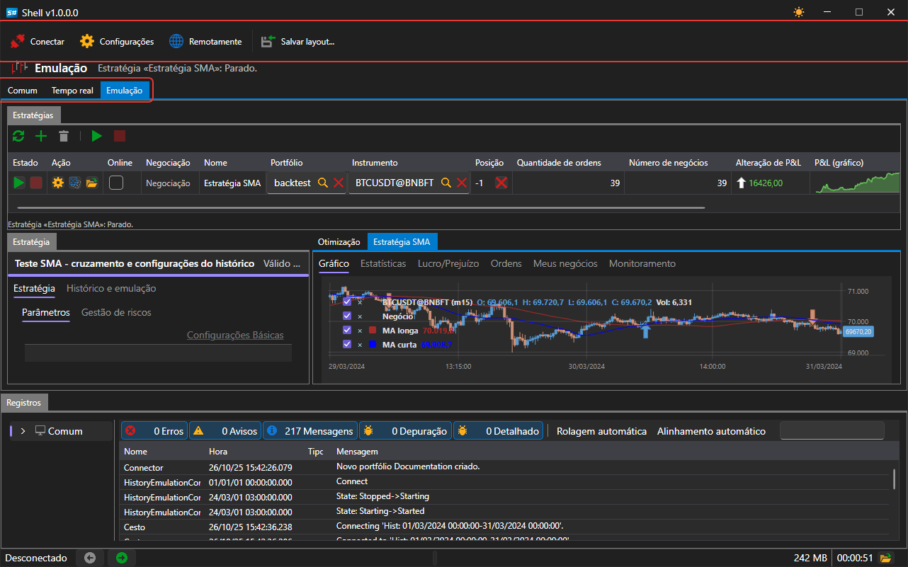
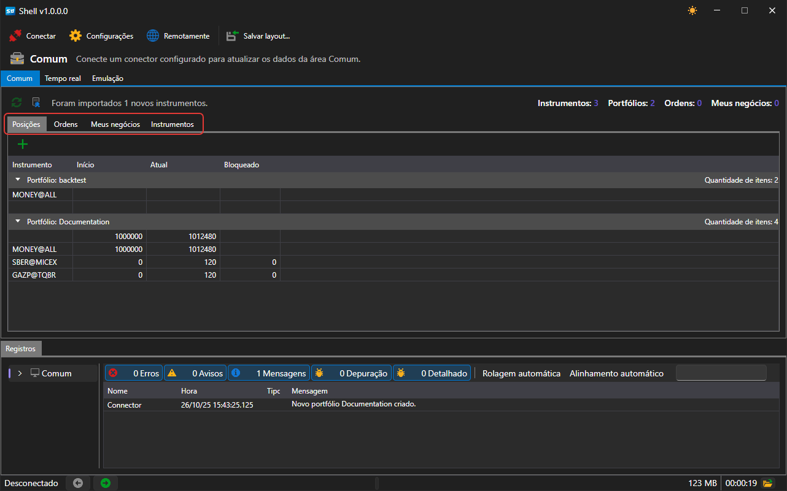
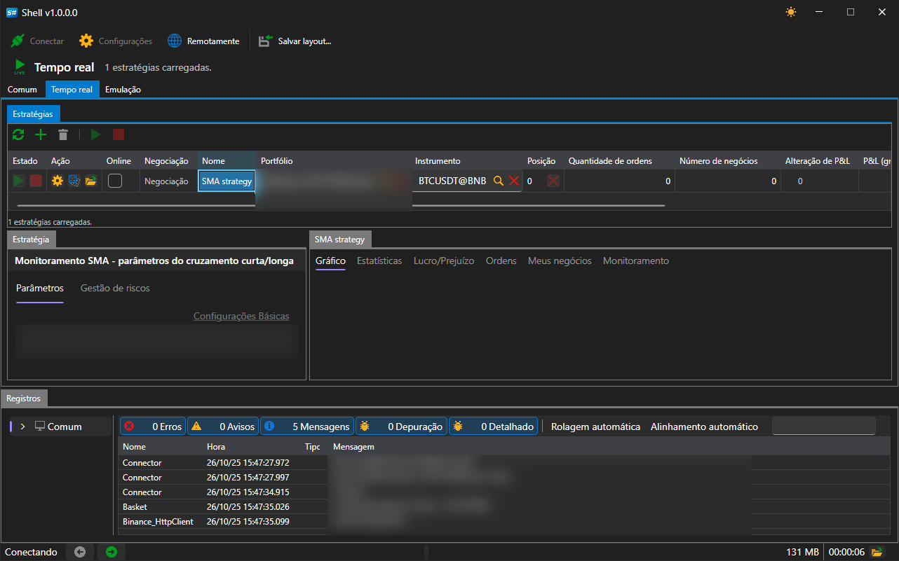
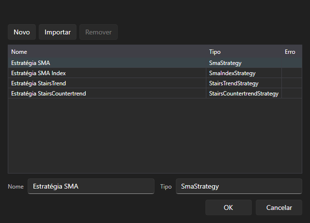
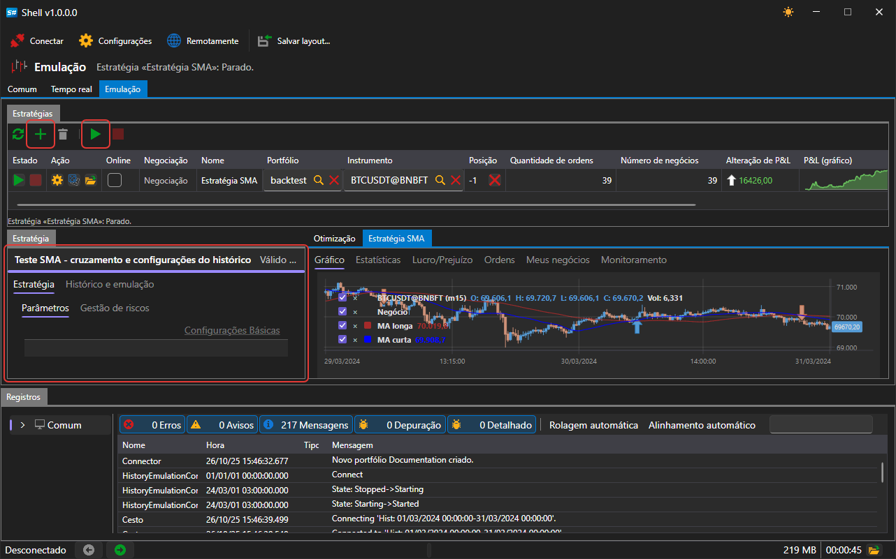

# Início rápido

O [Shell](../shell.md) é código-fonte em [C#](https://en.wikipedia.org/wiki/C_Sharp_(programming_language)) que se abre no Visual Studio, no Rider ou em qualquer outro ambiente e se executa como uma aplicação normal:

```
dotnet run --project Shell.Avalonia/Shell.Avalonia/Shell.Avalonia.csproj
```

Não é necessária nenhuma preparação prévia: o projeto executa-se tal como está e funciona de imediato com as estratégias incluídas.

## Janela principal

Depois do arranque, abre-se uma janela como esta:



À esquerda está a lista de áreas de trabalho entre as quais a aplicação alterna. Em cima está a barra de comandos: o botão das definições de ligação, o botão **Conectar** e a gravação da disposição atual dos painéis. Em baixo está a barra de estado com o estado atual da ligação.

Tudo o que o Shell grava (as definições de ligação, a disposição das janelas, a lista de estratégias, os esquemas importados do Designer e o armazenamento local de cotações) está na pasta `Data` junto ao executável.

## Ligação

Aceda às definições de ligação e selecione o conector necessário. Como configurar uma ligação está descrito em [Definições de ligações](connections_settings.md).

Em seguida, prima **Conectar**. O estado da ligação é apresentado na barra de estado e junto ao botão.

Depois de estabelecida a ligação, no separador [Comum](user_interface/common.md) aparecem as carteiras, os instrumentos, as ordens e os negócios próprios recebidos através da ligação.



## Estratégia em negociação

Aceda ao separador [Tempo real](user_interface/real_time.md).



Prima **Adicionar** e selecione a estratégia na janela que se abre.



A estratégia aparece na tabela **Estratégias** e os seus parâmetros, no painel **Estratégia** à esquerda. Preencha **Instrumento**, **Portfólio**, o volume e os parâmetros da própria estratégia e, em seguida, prima **Iniciar**.

Enquanto a ligação não estiver estabelecida, os botões para adicionar e iniciar desta área ficam indisponíveis; é isso que indica a dica por baixo da tabela.

## Estratégia no histórico

O mesmo no separador [Emulação](user_interface/emulation.md) inicia a estratégia nos dados históricos em vez de na negociação.



Para isso não é necessária ligação: cada execução lê o histórico do disco através do seu próprio conector de emulação.

## Conteúdo recomendado

[Comum](user_interface/common.md)

[Tempo real](user_interface/real_time.md)

[Emulação](user_interface/emulation.md)
