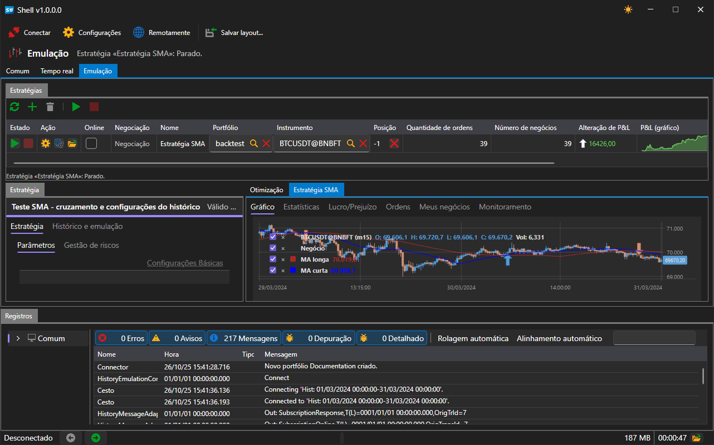

# Controlo remoto

O [Shell](../shell.md) consegue pôr as suas estratégias sob o controlo do site: o programa em execução regista-se como aplicação da sua conta, envia para lá o estado de cada estratégia e executa os comandos que chegam de lá. O controlo remoto do [Hydra](../hydra.md) e do [Designer](../designer.md) funciona da mesma forma, pelo que a lista de programas e os botões de controlo do [bot do Telegram](../telegram_services/control_panel.md) têm o mesmo aspeto para os três.

## Ativação

Na barra de comandos da janela principal há um interruptor **Remotamente**.

Enquanto está desativado, o [Shell](../shell.md) não se liga a lado nenhum e não aparece no site. O estado ativado é memorizado e restaurado no arranque seguinte do programa.

O interruptor só funciona quando o programa foi iniciado com uma conta StockSharp e o site está acessível. Sem iniciar sessão na conta, ativá-lo não serve de nada: a ligação não é aberta e a aplicação não é registada no site.

## O que está disponível remotamente

Remotamente estão disponíveis as estratégias da área [Emulação](user_interface/emulation.md), as que funcionam no histórico. As estratégias da área [Tempo real](user_interface/real_time.md) estão propositadamente indisponíveis: negoceiam com dinheiro real, e uma estratégia assim só pode ser iniciada no próprio computador. O mesmo limite é imposto pelo protocolo de comunicação entre processos que os scripts usam.

Uma estratégia não aparece no site por si só, mas apenas se as suas definições o permitirem. Abra a estratégia na área [Emulação](user_interface/emulation.md) e, nas suas definições, procure o grupo **Remotamente**:

| Definição | O que define |
|---|---|
| **Ativado** | se o site vê esta estratégia e pode controlá-la |
| **Notificação** | canal para onde vão as suas mensagens; se não for escolhido nenhum canal, o canal da conta |
| **Nível de registo** | a partir de que nível convém enviar uma mensagem para o canal |

Os canais são obtidos da conta, pelo que a lista aparece depois de iniciar sessão. A configuração de um canal no [Telegram](../telegram_services.md) está descrita na secção [Autorização](../telegram_services/authorization.md).

## Comandos

Do site ou do bot chegam comandos de dois tipos: sobre o programa como um todo e sobre uma estratégia concreta.

| Comando | O que faz |
|---|---|
| **Iniciar** para uma estratégia | inicia a execução se estiver parada ou tiver terminado com um erro |
| **Parar** para uma estratégia | para a execução em curso |
| **Iniciar** / **Parar** sem indicar estratégia | o mesmo, de uma só vez, para todas as estratégias que têm o controlo remoto permitido |
| **Ativar** / **Desativar** a negociação | passa a estratégia para o modo de negociação completa ou proíbe-a de negociar; a execução em curso aplica-o de imediato |
| **Parar** o programa | fecha o [Shell](../shell.md) |
| **Reiniciar** o programa | fecha o [Shell](../shell.md) e volta a iniciá-lo |

Um comando dirigido a uma estratégia que não tem o controlo remoto permitido é ignorado.

## O que é enviado para o site

- O estado do próprio programa: em execução enquanto a janela está aberta e parado quando é fechada.
- O estado de cada estratégia permitida, a cada alteração.
- As mensagens da estratégia, a partir do nível escolhido, para o canal escolhido. As mensagens iguais não se repetem.

## Conteúdo recomendado

[Painel de Controlo](../telegram_services/control_panel.md)

[Emulação](user_interface/emulation.md)
