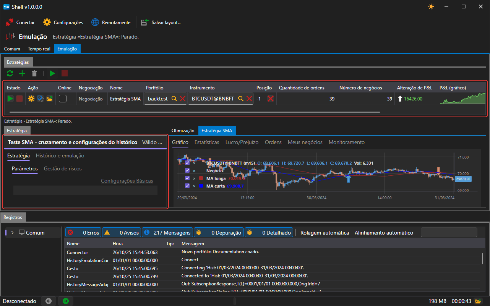
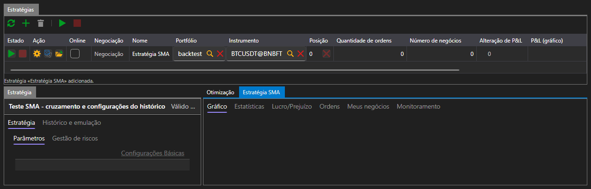
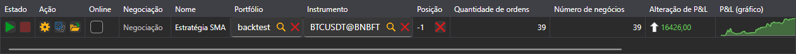
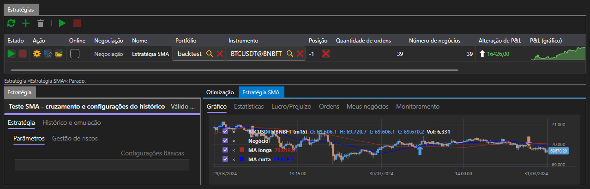
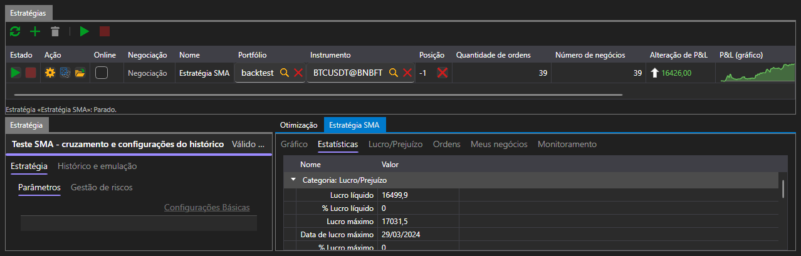
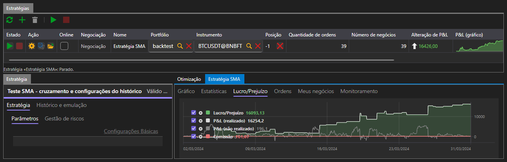
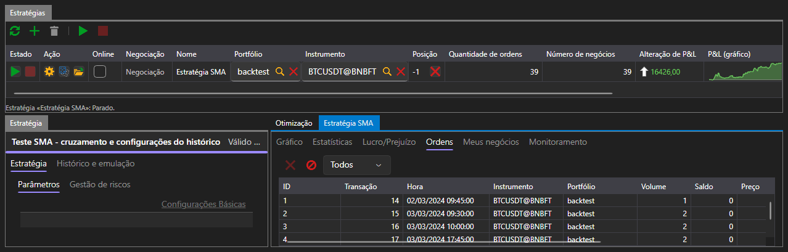
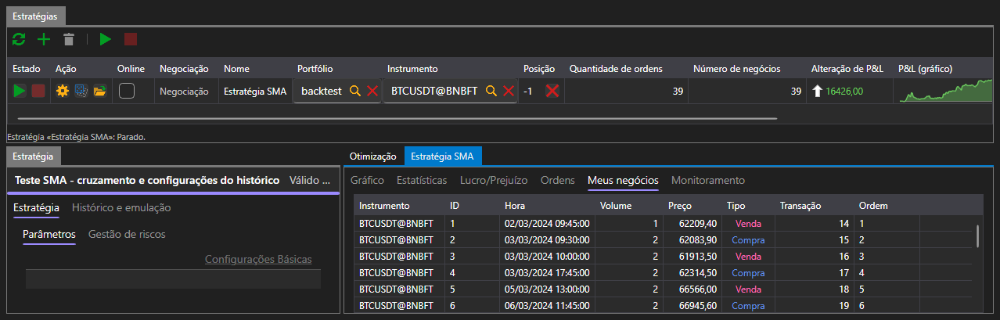

# Emulação

O separador **Emulação** executa a estratégia em dados históricos. Para isso não é necessária ligação: cada execução lê o histórico do disco através do seu próprio conector de emulação.

A área está organizada da mesma forma que [Tempo real](real_time.md): em cima, a tabela **Estratégias** com os botões; à esquerda, o painel da estratégia selecionada; à direita, separadores com tudo o que a execução produziu. As diferenças são dois separadores no painel da estratégia e o separador **Otimização** entre os resultados.

## Parâmetros da execução

À esquerda está o painel **Estratégia**, onde se define tudo aquilo com que a estratégia vai para o histórico. Tem dois separadores:

- **Estratégia**: instrumento, carteira, volume, regras de risco e parâmetros próprios da estratégia;
- **Histórico e emulação**: de onde obter os dados e como os entregar à estratégia.

| Parâmetro | O que define |
|---|---|
| **Caminho do histórico** | pasta da qual a execução lê velas e ticks |
| **De**, **Até** | primeiro e último dia da execução |
| **Formato de armazenamento** | de que forma o histórico está no disco |
| **Executar ao tocar** | executar a ordem quando o preço é tocado, sem esperar que seja atravessado |
| **Verificar o estado da negociação** | rejeitar as ordens enquanto o mercado não está a negociar |
| **Latência (ms)** | atraso entre o envio da ordem e a sua receção pelo mercado |

Por predefinição, é usado o histórico instalado juntamente com a plataforma e o período que esse histórico abrange, ou seja, a primeira execução pode ser iniciada sem alterar nada.

Se os parâmetros estiverem mal preenchidos (o caminho não está indicado, o fim do período é anterior ao início, a latência é negativa), por baixo da tabela aparece uma mensagem sobre isso e a execução não começa.

## Execução

O botão **Iniciar** começa a execução, e a barra por baixo do título do painel mostra quanto foi percorrido. A execução termina sozinha quando o histórico acaba; o botão **Cancelar** para-a antes do tempo.

Durante a execução e depois dela, a tabela de estratégias mostra o mesmo que na negociação: estado, posição, número de ordens e negócios, lucros e perdas.

## Resultado

À direita estão os separadores pelos quais se reparte tudo o que a execução produziu:

| Separador | O que mostra |
|---|---|
| **Gráfico** | as velas do instrumento e os negócios da estratégia sobre elas |
| **Estatísticas** | todos os indicadores que a plataforma calcula |
| **Lucro/Prejuízo** | a curva de rendibilidade |
| **Ordens** | todas as ordens registadas pela estratégia |
| **Meus negócios** | todos os negócios que realizou |
| **Otimização** | [pesquisa de parâmetros](optimization.md) |

### Gráfico

No gráfico estão as velas do instrumento com o qual foi feita a execução e as marcas dos negócios da estratégia sobre elas.

### Estatísticas

As estatísticas estão agrupadas por secções: lucros e perdas, negócios, ordens, latências. Entre outras coisas, mostram o lucro líquido, o rebaixamento máximo em dinheiro e em percentagem, o número de negócios lucrativos e com perdas, o lucro médio por negócio, o fator de lucro e os rácios de Sharpe, Sortino, Calmar e Sterling.

O número de negócios nas estatísticas é menor do que na tabela de estratégias: as estatísticas contam os negócios que fecharam algo, e o negócio que abriu a primeira posição não é incluído.

### Lucro/Prejuízo

A curva de rendibilidade mostra como variou o resultado da estratégia durante a execução.

### Ordens e negócios

No separador **Ordens** está tudo o que a estratégia registou: hora, direção, tipo, volume, preço e estado de cada ordem.

No separador **Meus negócios**, o que foi executado dessas ordens.

## Conteúdo recomendado

[Otimização](optimization.md)

[Tempo real](real_time.md)
