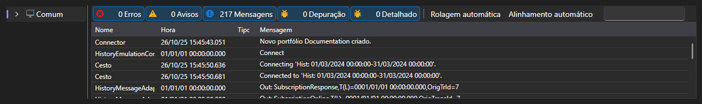

# Registros

O separador **Registros** mostra tudo o que a aplicação comunica sobre o seu funcionamento: mensagens da ligação, das estratégias, da emulação e do próprio Shell.

Cada entrada é composta pela hora, o nível (depuração, informação, aviso, erro), a origem e o texto. As entradas das estratégias estão marcadas com o identificador da estratégia, pelo que, com várias estratégias a funcionar ao mesmo tempo, se vê de quem é cada mensagem.

Por cima da tabela é apresentado quantos erros e avisos se acumularam, e um botão que limpa o registo. A própria tabela permite filtrar as entradas por nível, pesquisar por texto, escolher as colunas e exportar o conteúdo.

Os registos são o primeiro sítio para onde olhar se uma estratégia não arranca, não regista ordens ou a execução no histórico termina logo depois de começar.

## Conteúdo recomendado

[Comum](common.md)
