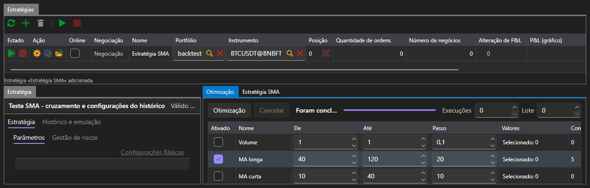

# Otimização

O separador **Otimização** escolhe os parâmetros da estratégia por pesquisa exaustiva: executa a mesma estratégia no mesmo histórico tantas vezes quantas as combinações de parâmetros e mostra o resultado de cada execução.

A otimização só está disponível na área [Emulação](emulation.md). Em [Tempo real](real_time.md) este separador não existe: com uma ligação real não há com que iterar os parâmetros.

## O que iterar

A tabela de parâmetros enumera os parâmetros da estratégia selecionada que podem ser iterados. Um parâmetro participa na iteração apenas se estiver assinalado; para um assinalado definem-se o início, o fim e o passo. O que se pode introduzir depende do tipo de parâmetro: num número inteiro são valores inteiros; num booleano, apenas dois valores.

À direita dos botões definem-se os limites da iteração:

| Campo | O que define |
|---|---|
| **Execuções** | quantas execuções fazer no máximo; 0, sem limite |
| **Lote** | quantas execuções realizar em simultâneo |

O número de combinações é recalculado à medida que os parâmetros são assinalados, pelo que se vê de antemão em que resultará a iteração.

## Progresso da iteração

O botão **Otimização** inicia a iteração e **Cancelar** para-a. A barra de estado indica o que está a acontecer: a iteração está a ser planeada, estão a ser feitas tantas execuções, a iteração parou depois de tantas execuções, a iteração não produziu nenhuma execução. A barra ao lado mostra quanto foi percorrido.

## Resultado

O resultado é mostrado de três formas ao mesmo tempo:

- uma tabela em que cada linha é uma execução com os seus valores de parâmetros, o lucro final e a curva de rendibilidade;
- uma superfície segundo dois parâmetros escolhidos;
- a mesma superfície sob a forma de mapa de calor.

Ao selecionar uma linha da tabela é mostrada a curva de rendibilidade dessa execução.

## Conteúdo recomendado

[Emulação](emulation.md)
