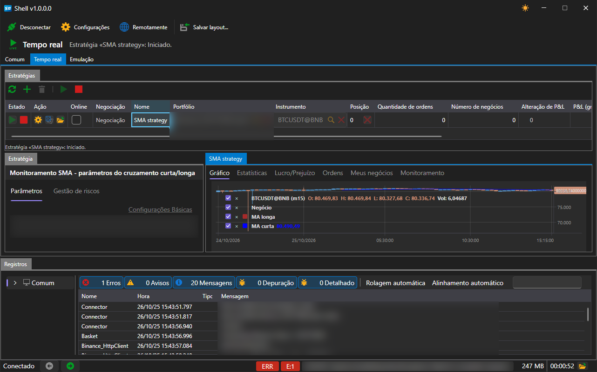

# Tempo real

O separador **Tempo real** gere as estratégias lançadas em negociação.

A área é composta por três partes:

- **Estratégias**: a tabela de todas as estratégias da área e os botões para as gerir, em cima;
- **Estratégia**: os parâmetros da estratégia selecionada, à esquerda;
- os separadores à direita (**Gráfico**, **Estatísticas**, **Lucro/Prejuízo**, **Ordens** e **Meus negócios**): tudo o que a estratégia selecionada mostra, regista e realiza.

Só é possível trabalhar com esta área com a ligação estabelecida: sem ela, os botões ficam indisponíveis, e por baixo da tabela é apresentada uma dica sobre isso.

## Botões

| Botão | O que faz |
|---|---|
| **Atualizar** | volta a ler a lista de estratégias |
| **Adicionar** | abre a janela de seleção de estratégia |
| **Excluir** | retira a estratégia selecionada da área |
| **Iniciar** | inicia a estratégia selecionada em negociação |
| **Parar** | para-a |

## Tabela de estratégias

Cada linha é uma estratégia. As colunas mostram o seu estado e o seu resultado:

| Coluna | O que mostra |
|---|---|
| **Estado** | parada, a arrancar, em funcionamento, a parar |
| **Ação** | início, paragem e fecho da posição diretamente a partir da linha |
| **Online** | se a estratégia recebe dados em tempo real |
| **Negociação** | modo de negociação da estratégia |
| **Nome** | nome dado ao adicioná-la |
| **Portfólio**, **Instrumento** | com o que negoceia |
| **Posição** | posição atual |
| **Quantidade de ordens**, **Número de negócios** | quantas ordens foram registadas e quantos negócios foram realizados |
| **Alteração de P&L**, **P&L (gráfico)** | lucros e perdas e a sua evolução |
| **Lucro realizado**, **Lucro não realizado** | parte fechada e aberta do resultado |
| **Erro** | último erro da estratégia, se tiver havido |

## Adicionar uma estratégia

O botão **Adicionar** abre uma janela com a lista de estratégias disponíveis.

A janela enumera as quatro estratégias incluídas e tudo o que foi importado do [Designer](../run_strategies_from_designer.md). O botão **Importar** adiciona a esta lista um esquema exportado do Designer; o botão **Novo**, um modelo para uma estratégia própria; o botão **Excluir** retira da lista a entrada selecionada.

Depois de premir **OK**, a estratégia aparece na tabela e no painel **Estratégia** abrem-se os seus parâmetros: instrumento, carteira, volume, regras de risco e parâmetros próprios da estratégia, por exemplo, os comprimentos das médias móveis e o período das velas para **SMA strategy**.

## Conteúdo recomendado

[Comum](common.md)

[Emulação](emulation.md)
