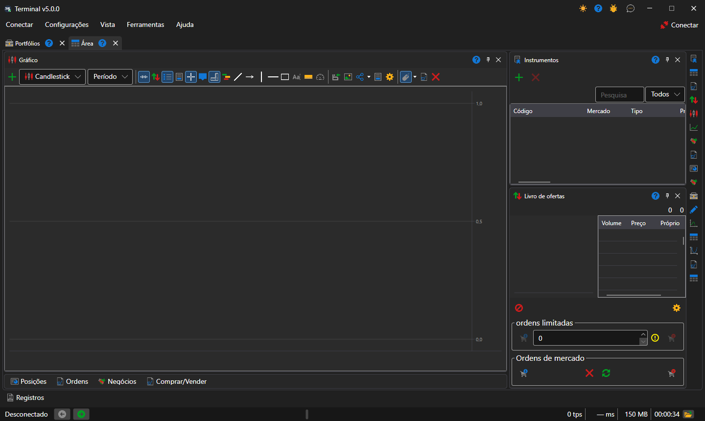
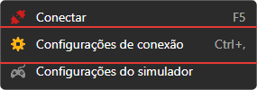
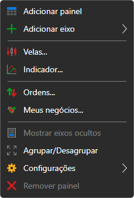
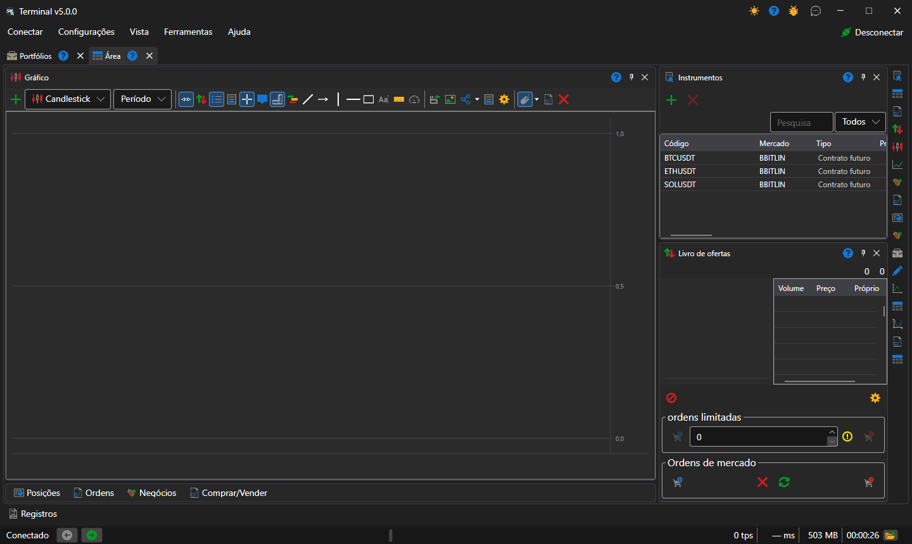
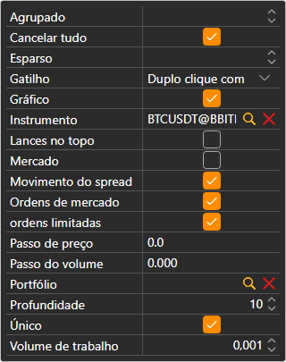
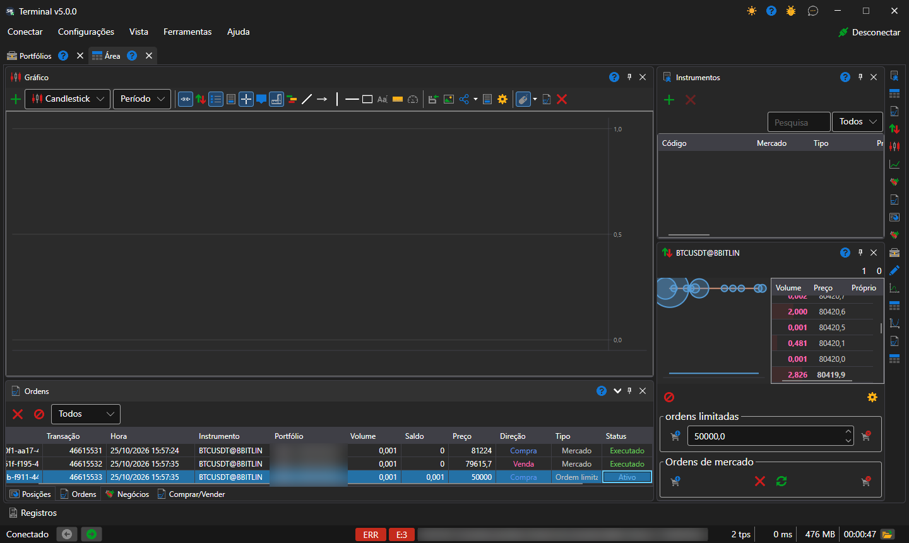
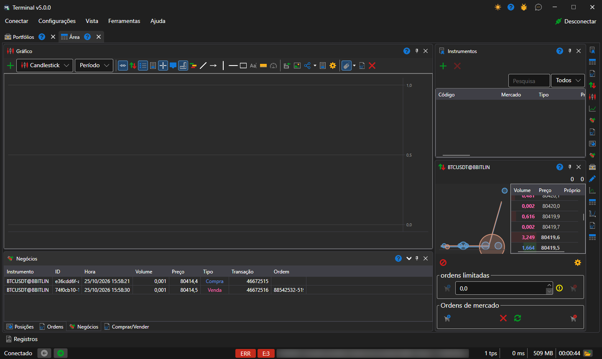
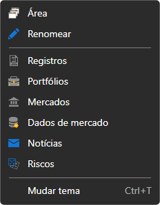

# Início rápido

Quando inicia o [Terminal](../terminal.md) pela primeira vez, abre-se uma janela com uma [área de trabalho](user_interface/workspace.md) organizada por predefinição: o gráfico no centro; à direita, os instrumentos e o livro de ordens, e por baixo do gráfico, os separadores recolhidos de posições, ordens, negócios e o ticket **Comprar/Vender**.

Vamos às definições de ligação (menu **Conectar → Configurações de conexão**) e selecionamos a ligação necessária. A forma de configurar a ligação é descrita na secção [Definições de ligação](connection_settings.md).

O passo seguinte é estabelecer ligação clicando no botão **Conectar** no fim da linha do [menu principal](user_interface/ribbon.md) ou com a tecla **F5**.

Ao clicar no botão **Adicionar**  no painel do gráfico, adicionamos uma nova área de gráfico. Ao clicar com o botão direito do rato na área do gráfico, adicionamos velas para o instrumento que nos interessa. Podemos adicionar indicadores, negócios próprios e ordens ao gráfico. Também existe a possibilidade de registar ordens a partir do gráfico. Para obter mais informações sobre como trabalhar com o gráfico, consulte a secção [Gráfico](user_interface/components/chart.md).

Ao clicar no botão **Adicionar**  no painel Instrumentos, adiciona os instrumentos que pretende acompanhar. Os dados do melhor preço serão apresentados aqui. Para obter mais informações sobre como trabalhar com o painel Instrumentos, consulte a secção [Instrumentos](user_interface/components/instruments.md).

No livro de ofertas, depois de clicar no botão **Definições** , aparece um painel onde pode especificar o **Instrumento** e a **Carteira** para os negócios. Aqui também pode ajustar a profundidade do livro de ofertas. Para obter mais informações sobre como trabalhar com um livro de ofertas, consulte a secção [Livro de ofertas](user_interface/components/order_book.md).

Vamos registar as primeiras ordens. As ordens podem ser registadas clicando nos botões **Comprar/Vender** ou com um duplo clique nas células das colunas **Compra/Venda** do próprio livro de ofertas. O painel de ordens apresenta todas as suas ordens. Ao clicar com o botão direito do rato numa ordem, verá um painel que permite submeter uma nova ordem, cancelar ou alterar a ordem selecionada. Para obter mais informações sobre como trabalhar com o painel de ordens, consulte a secção [Ordens](user_interface/components/orders.md).

No painel Negócios, pode ver negócios por instrumentos. Para obter mais informações sobre como trabalhar com o painel Negócios, consulte a secção [Negócios](user_interface/components/trades.md).

Se necessário, pode adicionar componentes adicionais com os botões da faixa junto à margem direita da área de trabalho; os painéis de toda a janela, por exemplo, **Portfólios** e **Registros**, abrem-se a partir do menu **Vista**. Todos os componentes são descritos na secção [Componentes](user_interface/components.md).

