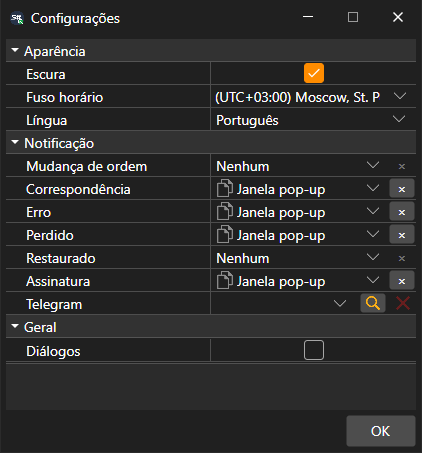

# Definições gerais

A janela **Configurações** abre-se com a opção **Configurações → Configurações** do [menu principal](../user_interface/ribbon.md). As definições estão divididas em grupos:

- **Aparência**:
  - **Escura**: tema escuro; também é alterado pelo botão do título da janela;
  - **Fuso horário**: em que fuso horário é apresentada a hora dos dados de mercado;
  - **Língua**: língua do programa.
- **Geral**:
  - **Diálogos**: mostrar uma janela com o erro que o programa não tratou por si só. Se a caixa estiver desmarcada, esse erro é apenas escrito no registo.
- **Notificação**: sobre que eventos das ordens e da ligação informar e de que forma, bem como o canal do Telegram para essas mensagens. Com mais detalhe, na secção [Notificações](../notifications.md).

O tema muda assim que se prime **OK**. A língua e o fuso horário aplicam-se depois de reiniciar, pelo que o Terminal pergunta se deve reiniciar já.

## Ver também

[Repor definições](reset_settings.md)

[Notificações](../notifications.md)
