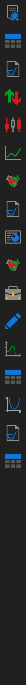

# Componentes

Durante a negociação é preciso ver o mercado, as ordens e as posições próprias. Para isso, à [área de trabalho](workspace.md) adicionam-se componentes gráficos com os botões da faixa vertical junto à margem direita da área. Cada clique abre mais um painel desse tipo.

- [Instrumentos](components/instruments.md) - tabela com instrumentos que apresenta informações sobre todos os instrumentos selecionados.
- [Level 1](components/level_1.md) - tabela com o histórico de alterações de Level 1 para os instrumentos selecionados.
- [Compra/Venda](components/buy_sell.md) - grupo de tickets nos quais se veem os melhores preços dos instrumentos e com os quais se registam e cancelam ordens.
- [Livro de ofertas](components/order_book.md) - tabela de ordens limite de compra e venda.
- [Gráfico](components/chart.md) - velas e indicadores do instrumento selecionado; também é possível negociar a partir do gráfico.
- [Curva de P&L](../../designer/user_interface/components/pnl_equity.md) - gráfico de lucros e perdas (não realizados e realizados) e da comissão.
- [Meus negócios](../../designer/user_interface/components/trades.md) - tabela de negócios próprios.
- [Ordens](components/orders.md) - tabela de ordens próprias; por cima, os botões de cancelamento de ordens e a escolha de que ordens mostrar.
- [Posições](components/positions.md) - tabela das posições atuais; por cima, os botões para fechar e reverter a posição.
- [Negócios tick](../../designer/user_interface/components/tick_trades.md) - tabela de todos os negócios do mercado para os instrumentos selecionados.
- [Posições (gráfico)](../../designer/user_interface/components/positions.md) - gráfico da posição.
- **Propriedades** - propriedades do objeto selecionado na área: instrumento, ordem, negócio, posição.
- [Posições (opções)](components/positions_options.md) - apresentação gráfica da posição por opções.
- [Painel de opções](components/option_desk.md) - tabela dos principais parâmetros das opções para o instrumento subjacente.
- [Sorriso de volatilidade](components/smile_volatility.md) - volatilidade esperada das opções com o mesmo ativo subjacente e diferentes strikes.
- [Registo de ordens](components/order_log.md) - tabela de todas as ordens do mercado para os instrumentos selecionados.
- [Level 2](components/level_2.md) - livro de ordens de um instrumento em duas tabelas com um ticket por baixo.

Os painéis de toda a janela ([Registos](logs.md), [Portefólios](portfolios.md), [Editor de mercados](board_editor.md), **Dados de mercado**, [Notícias](components/news.md) e [Riscos](risk_management.md)) abrem-se a partir do menu **Vista** do [menu principal](ribbon.md).

As tabelas de todos os componentes funcionam da mesma forma: como copiá-las, pesquisar nelas, filtrá-las, ordená-las e configurar as colunas está descrito na secção [Trabalho com tabelas](tables.md).
