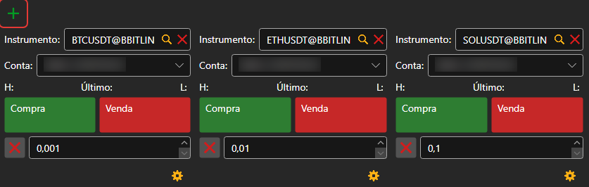
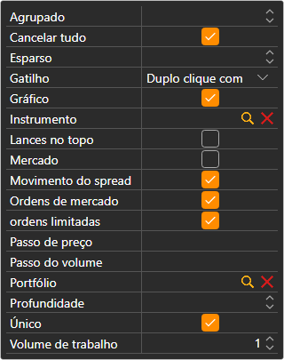

# Compra/Venda

O componente **Compra/Venda** é um grupo de tickets. Cada ticket mostra os melhores preços de um instrumento e regista ordens sobre ele na carteira selecionada. Um ticket adiciona-se com o botão ; na primeira ligação, o painel cria sozinho tickets para os primeiros instrumentos do mercado.

## Definições do ticket

O botão com a roda dentada por baixo do ticket abre as suas definições: **Instrumento**, **Portfólio**, **Volume de trabalho**, **Profundidade** do livro de ordens e que blocos o ticket mostra:

- **Ordens limitadas**: os botões **Comprar** e **Vender** com um campo de preço entre eles; os botões junto ao campo colocam nele o melhor preço de compra ou de venda;
- **Ordens de mercado**: **Comprar**, **Vender**, **Fechar posição** e **Reverter posição** ao mercado;
- **Cancelar tudo**: um botão que cancela todas as ordens do instrumento do ticket.

O instrumento do ticket pode ser alterado arrastando para o ticket uma linha de [Instrumentos](instruments.md); se for arrastada uma linha de [Posições](positions.md), o ticket fica com o seu instrumento e a sua carteira.

## Teclas de atalho

O ticket do painel **Compra/Venda** da [área de trabalho](../workspace.md) aberta nesse momento responde às teclas: **F9**, comprar ao mercado; **F10**, vender ao mercado; **Esc**, cancelar todas as ordens. Enquanto o cursor estiver num campo de entrada, as teclas não funcionam.

> [!WARNING]
> **F9** e **F10** enviam para o mercado ordens de mercado reais sem confirmação.

## Conteúdo recomendado

[Livro de ofertas](order_book.md)

[Level 2](level_2.md)

[Menu principal](../ribbon.md)
