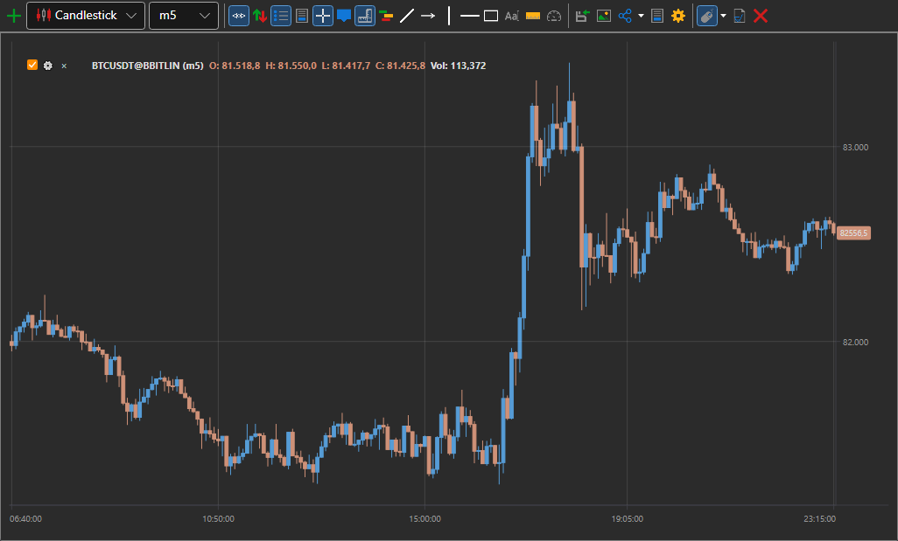
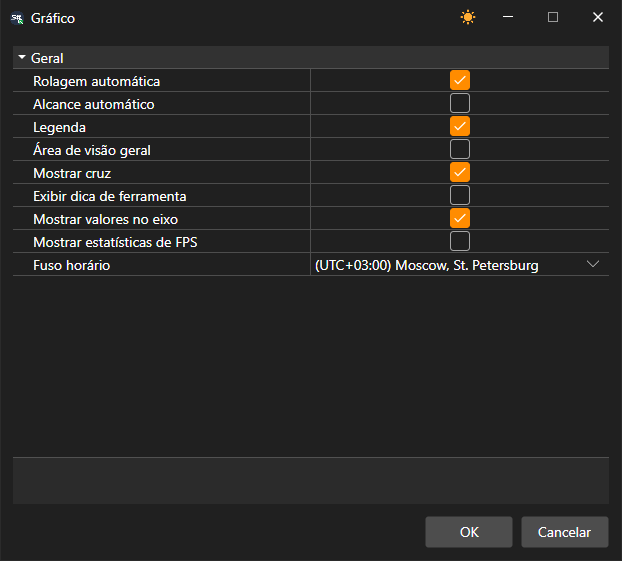
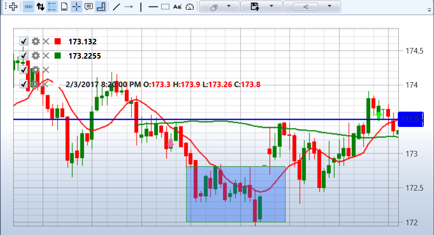

# Gráfico

O componente **Gráfico** permite desenhar velas e indicadores para o instrumento selecionado.

Para adicionar uma nova área, clique no botão .

Para adicionar um novo elemento ao gráfico, clique com o botão direito do rato em qualquer ponto da área do gráfico e selecione o elemento necessário; as opções disponíveis incluem velas, indicadores, ordens e negócios próprios.

O canto superior esquerdo de cada gráfico mostra todos os elementos gráficos adicionados ao gráfico. Se desmarcar a caixa de seleção  de um elemento gráfico, esse elemento também é removido do gráfico.

Ao clicar em , são abertas as definições do elemento gráfico.

## Negociação a partir do gráfico

A partir do gráfico é possível registar, mover e cancelar ordens. Primeiro, ativa-se o interruptor **Colocar ordens a partir do gráfico** na barra de botões do gráfico e, nas suas definições pendentes, indicam-se o **Instrumento**, o **Portfólio** e o volume da ordem.

- Uma ordem de compra regista-se com a combinação **Ctrl+botão esquerdo do rato** sobre um preço do gráfico, e uma ordem de venda, com **Ctrl+botão direito do rato**.
- As ordens ativas próprias são desenhadas no gráfico como linhas nos seus preços. Uma linha pode ser arrastada para outro preço e a ordem é movida; a cruz junto à linha cancela a ordem. O botão **Cancelar ordens** cancela todas as ordens do gráfico.
- O botão **Mostrar painel de entrada de ordens rápidas** mostra por cima do gráfico um painel com os botões **Vender** ao melhor preço de compra e **Comprar** ao melhor preço de venda, o spread entre eles e o volume da ordem. O painel pode ser arrastado para qualquer sítio do gráfico.

> [!WARNING]
> As ordens a partir do gráfico são enviadas para o mercado de imediato, sem confirmação.

## Definições do gráfico

O botão **Configurações** da barra de botões do gráfico abre a janela de definições de todo o gráfico: deslocamento automático e escala automática, legenda, área de visualização, cruz, dica, valores nos eixos, estatísticas de FPS e o fuso horário com que a escala de tempo é legendada.

Um clique direito na própria barra de botões abre a lista dos seus botões: a caixa desmarcada oculta o botão e a marcada volta a mostrá-lo. Os botões mostrados são guardados juntamente com o gráfico.

O botão **Área de transferência (como imagem)** copia a imagem do gráfico para a colar numa mensagem ou num documento. Um clique direito num elemento do gráfico abre um menu com as opções **Parâmetros de elemento…** e **Excluir**; no menu da área do gráfico estão **Configurações → Área do gráfico…** e **Remover painel**. O painel por baixo do gráfico também se fecha com a cruz do seu título.

O gráfico desloca-se com as setas **←** e **→**, as teclas **Home** e **End** vão para o início e para o fim dos dados, e **+** e **−** alteram a escala.

Nas definições do elemento gráfico, pode definir o estilo de gráfico necessário: velas japonesas, barras, gráfico Box, perfil de clusters, etc.

Para um gráfico Box, as velas também podem ser agrupadas; a ordem de agrupamento é definida nos campos: multiplicador do 2.º período e multiplicador do 3.º período.

Existe uma barra de ferramentas acima do gráfico, onde pode selecionar deslocamento automático, zoom automático, modos de legenda e outras definições gerais do gráfico. Também pode selecionar os elementos a desenhar no gráfico: linhas, níveis, ponteiros, retângulo, texto.

## Consulte também

[Ordens](../../../designer/user_interface/components/orders.md)
