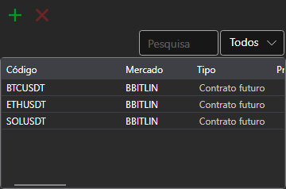

# Instrumentos

O componente **Instrumentos** (o título do painel é **Instrumentos**) é uma tabela com instrumentos que apresenta informações sobre todos os instrumentos selecionados.

Para adicionar um novo instrumento, clique no botão . Abre-se a janela de seleção de instrumentos: tem pesquisa, filtro por tipo de instrumento e por mercado, e enquanto a lista de instrumentos é carregada, por baixo da tabela vê-se uma barra de carregamento. O botão **Excluir instrumentos** retira da tabela os instrumentos selecionados.

O instrumento selecionado na tabela é mostrado no painel **Propriedades** da mesma área de trabalho. Se o gráfico da área ainda não tiver um instrumento para o qual regista ordens, o instrumento selecionado passa a sê-lo.

A linha de um instrumento pode ser arrastada com o rato para outro painel da área ([Compra/Venda](buy_sell.md), [Level 1](level_1.md), [Level 2](level_2.md), [Livro de ofertas](order_book.md) ou [Gráfico](chart.md)), e o painel muda para esse instrumento.

Como copiar as linhas, pesquisá-las e filtrá-las e configurar as colunas está descrito na secção [Trabalho com tabelas](../tables.md).

## Conteúdo recomendado

[Level 1](level_1.md)
