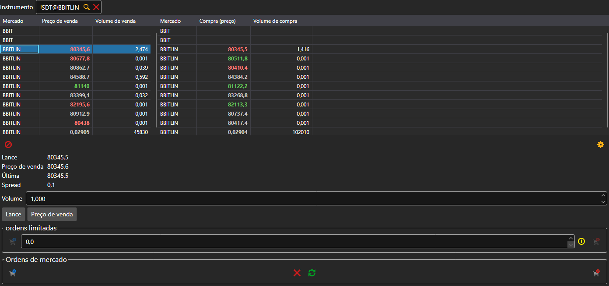

# Level 2

O componente **Level 2** mostra as cotações de um instrumento em todos os mercados ao mesmo tempo: nas tabelas entra cada instrumento com o mesmo código, uma linha por instrumento. Na tabela da esquerda estão o melhor preço e o volume de venda; na da direita, os de compra. O instrumento escolhe-se no campo por cima das tabelas ou arrasta-se para o painel a partir de [Instrumentos](instruments.md).

Por baixo das tabelas estão o preço de compra, o preço de venda, o último preço e o spread da linha selecionada na tabela. Os botões **Lance** e **Preço de venda** colocam esse preço na ordem limitada, e mais abaixo está o mesmo ticket que no componente [Compra/Venda](buy_sell.md): ordens limitadas e de mercado.

## Conteúdo recomendado

[Livro de ofertas](order_book.md)

[Compra/Venda](buy_sell.md)
