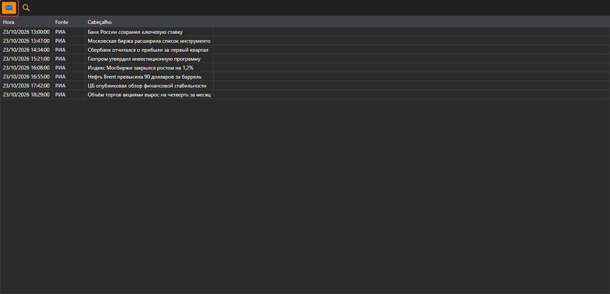

# Notícias

O componente **Notícias** apresenta notícias recebidas das ligações.

Para começar a receber notícias, clique no botão **Receber notícias**.

## Conteúdo recomendado

[Posições (opções)](positions_options.md)
