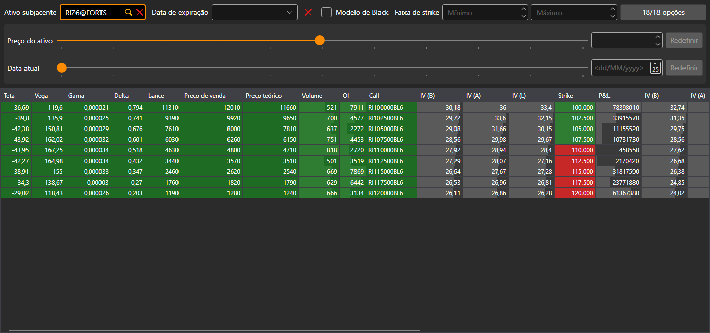

# Painel de opções

O componente **Painel de opções** é uma tabela dos principais parâmetros das opções para o instrumento subjacente: cada linha da tabela é um strike; à esquerda, os parâmetros da call e, à direita, os da put.

## Filtro de opções

Por cima da tabela há um filtro. É igual em todos os componentes de opções: o painel, o [sorriso de volatilidade](smile_volatility.md) e as [posições por opções](positions_options.md):

- **Ativo subjacente**: o instrumento cujas opções são mostradas;
- **Data de expiração**: mostrar apenas as opções desta data de expiração; o botão ao lado limpa o filtro;
- **Modelo de Black**: calcular os preços teóricos, a volatilidade e as gregas com o modelo de Black (para opções sobre futuros), e não com o modelo de Black-Scholes;
- **Faixa de strike**: strike mínimo e máximo;
- o botão com o número de opções abre a janela de seleção de opções do ativo subjacente. No botão vê-se quantas das opções selecionadas passam o filtro e quantas estão selecionadas no total.

Por baixo do filtro está o cálculo «e se». O controlo deslizante **Preço do ativo** e o campo ao lado definem outro preço do ativo subjacente, e o controlo deslizante **Data atual** e o calendário, outra data atual. Os cálculos do componente são feitos para estes valores, e os botões **Redefinir** repõem o preço e a data reais.

## Tabela

Os strikes «dentro do dinheiro» estão destacados: na call são os strikes abaixo do preço do ativo subjacente e, na put, os acima.

Um duplo clique numa célula da call ou da put abre o livro de ordens dessa opção.

## Conteúdo recomendado

[Sorriso de volatilidade](smile_volatility.md)

